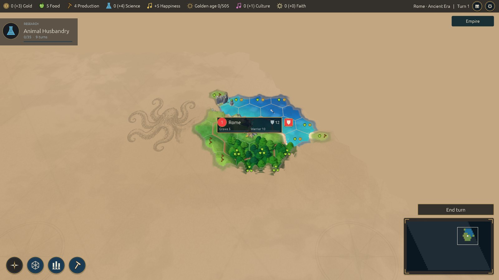
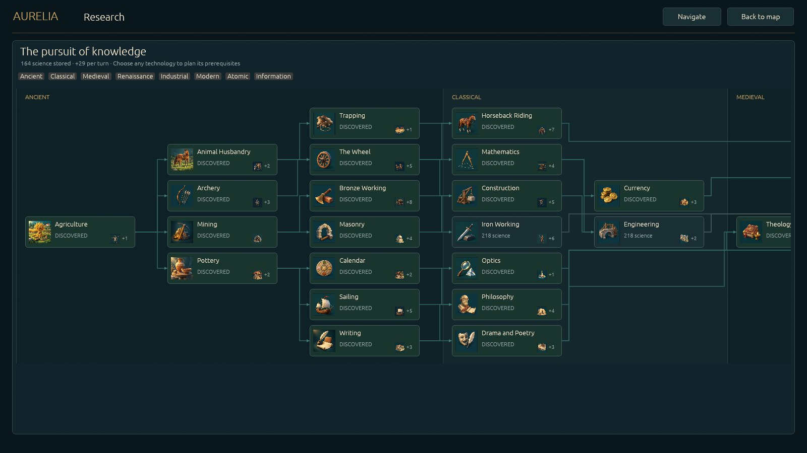
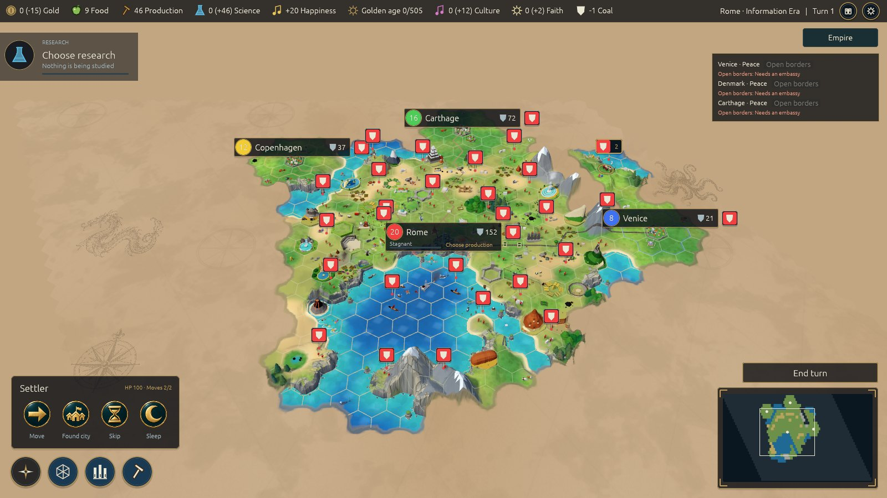

# Aurelia: Classic

A turn-based 4X strategy game: a game inspired by Unciv, with a similar rule set (cities, a tech tree, policies,
religion, city states, diplomacy, trade, espionage, ...), with its own AI and its own user interface.

**[Play in the browser: aurelia.romanivanov.dev](https://aurelia.romanivanov.dev/)**, or download it for macOS, Windows, Linux and Android from the [releases page](https://github.com/sirgl/aurelia-classic/releases).

**Aurelia is a non-profit hobby project.** It is free and open source, has no advertising and no paid content, and it is not
affiliated with, or endorsed by, the makers or publishers of any other game.

<p>
  
  
</p>
<p>
  
</p>

## Built on the Aurelia core

Classic is a rule module of the Aurelia core, the engine of [aurelia-platform](https://github.com/sirgl/aurelia-platform):
the deterministic game kernel, the renderer, the client shell with its screens, saves and replays, and the launchers.
The core knows nothing about the rules of a particular game; this repository holds the rules, the data, the AI and the
user interface of Classic on top of it.

## Thank you, Unciv

A very big thank you to the creators and all the contributors of [Unciv](https://github.com/yairm210/Unciv), the open
source strategy game. Without Unciv this project would not exist in this form: the rule data of Classic (units,
buildings, technologies, policies, beliefs, terrain, the numbers behind them) and many of its formulas are taken from
Unciv, which is licensed under the Mozilla Public License 2.0. The attribution, the list of what comes from where and
the licence texts are in [docs/classic/UNCIV-ATTRIBUTION.md](docs/classic/UNCIV-ATTRIBUTION.md), [NOTICE](NOTICE) and
[LICENSE-MPL-2.0](LICENSE-MPL-2.0).

## Is this legal?

Game mechanics are not protected by copyright (see the [US Copyright Office circular FL-108](https://upload.wikimedia.org/wikipedia/commons/9/96/U.S._Copyright_Office_fl108.pdf)).
Aurelia uses no image, sound, name or logo of any other game, and it does not present itself as one; its art, music and
texts are its own (see [LICENSE-ART](LICENSE-ART)), and the rule data that comes from Unciv is marked as such (see above).

## The computer opponents

The AI is a set of planners for cities, workers, armies, sieges and diplomacy, steered by a small strategy net whose
266 weights are written by hand, each with its reason ([docs/ai-strategy-net.md](docs/ai-strategy-net.md)): it chooses
the research, the policies and what the cities build. It runs on the CPU and downloads nothing.

## Plans

Not in 0.2:

- Network play: several people in one game, with simultaneous turns and chat. The protocol and the match logic exist in the platform (`net`); the server program and the screens do not.
- A new neural-network AI.
- Music that follows the era and the mood of the game.
- Better models and animations.
- A more detailed interface.

## Known problems

- Rebellions are not implemented: low happiness and an empty treasury cost growth, production, science and units, but no rebels rise and no city revolts.
- The interface is not always the best.

## Running the game

```sh
# needs the platform folder, named "platform", beside this one: ../platform  (clone aurelia-platform into it)
cd classic
cargo +1.98.1 run --release -p classic-desktop      # the game "Aurelia" (binary aurelia-classic)
```

The run-time art pack is not in git: `sh ../platform/tools/fetch-assets.sh` unpacks it into
`assets/visual/generated` (its version is `assets/PACK-VERSION`); without it the game runs with placeholder pictures.
Rust 1.98 or newer is needed; `cargo +1.98.1 test --release --workspace` runs the tests.

## Play in the browser

The same game is built for the browser as WebAssembly (`launcher/web`), so it can be played without installing anything:
**<https://aurelia.romanivanov.dev/>**. `aurelia-<version>-web.zip` on the
[releases page](https://github.com/sirgl/aurelia-classic/releases) is the same page for self-hosting: unzip it onto any static host
that serves `.wasm` as `application/wasm`.

In the browser:

- Saves, autosaves and settings are kept in the browser's own storage on this device (clearing the site's data deletes them; a private window forgets them when it closes).
- There is no network play (there is none in the desktop and Android builds either).
- It needs WebGPU or WebGL2; it is tested in Chrome on the desktop, not yet in Firefox, Safari or on phones.
- The first load is about 13 MB before the menu; the rest of the art loads while you play.

It can also be built and served locally:

```sh
# from the folder that holds both "classic" and "platform"; needs the wasm32 target of the toolchain
# (rustup +1.98.1 target add wasm32-unknown-unknown), wasm-bindgen-cli 0.2.129 and the art pack (see above)
AURELIA_ROOT=$PWD sh platform/tools/launcher/web-build.sh classic/launcher dist/web
python3 platform/tools/launcher/web-serve.py dist/web --port 8080      # then open http://localhost:8080
```

## Android

The APK is on the [GitHub Releases](https://github.com/sirgl/aurelia-classic/releases) page. It is signed with the
project's own key (it is not in Google Play), so Android asks to allow installing apps from your browser or file
manager. It needs a 64-bit ARM device with Android 8 or newer and Vulkan, plays in landscape, and has no network play.
