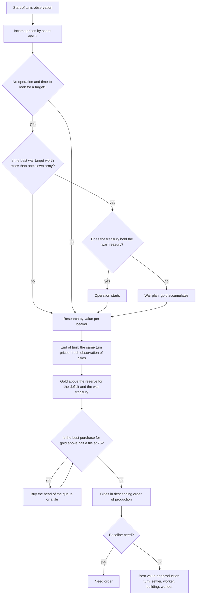

# AI allocator: goals and value in score points

> Variant names in the records are as of the day of the record; `standard` between promotions is today's `allocator`, `baseline` is `legacy`. The correspondence table, the current `standard` and the status of the goals are in [ai.md](ai.md), sections 3–4. State of the document: 16–19 October 2026.

Step 4 of the section "M6.2. A coherent AI" ([ai.md](ai.md)). The AI variant `economy` (`classic_rules::ai::variant`, code in
`ai/value.rs`, `ai/allocator.rs`) is built on `operations` (classic/docs/ai-operations.md): tactics, operations and
unit tasks are the same, but city production, gold, research and the decision to start a new war are measured by a single
measure: score points, the score that decides the time victory. The variant `economy-peace` is the same allocator
without new wars: a control that separates the contribution of the economy from the contribution of wars.

**Result:** the goal of the step is reached. Against `baseline` it wins 75.5% of games (Wilson 95% CI 71.1–79.5%) on the main
set and 76.5% (72.1–80.4%) on the held-out set; against `operations`, 66.8% (62.0–71.2%) and 70.2%
(65.6–74.5%). A recalculation of the already promoted `standard` with an interval by seed blocks (platform/docs/ai-bench.md,
"Statistics"): against `legacy` 72.0% (68.0–76.2%), 76.2% (73.0–79.2%) and on the new set 73.8%
(70.0–77.5%); against `operations` 67.8% (64.0–71.8%), 67.2% (63.7–70.8%) and 70.6% (66.6–74.5%). By the end of the game `economy` has 120 more score points (731 against 606): wonders 5.4 against 3.3,
citizens 56.6 against 49.3, cities 7.0 against 5.5, tiles 119 against 99. The whole gain is the economy: without new
wars (`economy-peace`) the share is the same (75.8% and 77.0%), and `economy` against `economy-peace` is 49.5% on both
sets. The recalculation by seed blocks refines this: `standard` against `standard-peace` is 49.0% (48.0–49.8%), 50.2%
(50.0–50.7%) and 50.0% (49.0–51.0%) on the three sets (almost all games are identical, the plan effect is 0.01–0.04), and
the paired score difference on all three is −3.4…−5.0 points per seat: wars add nothing in terms of victory value and cost
a little score. Round time is within the contract: the bench p95 is lower (13.1–13.3 against 15.3 ms for `baseline`), the
`ai_rounds representative` round is +9–11%. Not achieved:
gold income at rounds 100 and 200 is lower than `baseline`'s, and the technology count is the same (see "What limits it").
Step 6, economy: the variant `standard-econ2` (now `allocator-econ2`; section "Gold and happiness") values gold by its best use and
happiness by its effect; against `standard` it scores 65.5% on the held-out set, but happiness is worse by the end of the game.

## Currency: final score points

All bench games end with a time victory in the last round (platform/docs/ai-bench.md): it goes to the player with the best
score. Therefore the allocator's measure of value is the score gain by the last round, in hundredths of a point
(`value::Centi`).

### Score formula

What this game counts (`systems::victory::score`, classic/docs/classic/rules.md):

| Term | Points per unit | Map correction |
|---|---:|---|
| city | 8 | × M / 100 |
| citizen | 4 | × M / 100 |
| land tile within borders | 1 | × M / 100 |
| wonder of the world | 25 | — |
| technology | 4 | — |

M is the map size correction: `M = 100 · 4160 / map tiles` (4160 = 80 × 52, the Standard map); values above 100 are
compressed: `(M − 100) / 3 + 100`. The bench maps are smaller than Standard: tiny (56 × 36) has M = 135, small
(66 × 42) has M = 116. In Civ V the score also includes policies (4), great works (4), beliefs of
one's own religion (20), cities of one's own religion (1) and future technologies (10). Policies, religion and great
works already exist in the game, but the time-victory formula (`systems/victory.rs::score`) counts only the five
rows of the table above: that is this game's rule today, not a "still 0" defect (an old comment in the code
said so; it has been fixed). The allocator values the same five rows. Adding the rest is the project owner's decision:
it would shift all game hashes and AI prices.

The source is the behavior of the game, not its code: the Civ V "Victory and Score" screen (Victory Progress → Score) shows
each player's score by these rows; the multipliers and the map correction come from the public wiki, "Score
(Civ V)" (the site was unavailable in this session; the numbers were checked against the old hand-written classic/docs/classic/rules.md, which
is now replaced by a file generated from the code).

What the `baseline` score consists of at the end of a game (bench, ≈ 600 points): citizens ≈ 40%, technologies ≈ 22%,
wonders ≈ 15%, land ≈ 15%, cities ≈ 8%. The measurement that showed this first: a variant that builds no wonders
wins 7.5% of games (160 games), even though it has as many cities and citizens: a wonder is worth 25 points and
takes them away from the rival.

### Shadow prices

Everything an empire produces is valued by what it will add to these counters by the last round. T is the number of rounds
until the time victory (`victories.max_rounds − round`, shown on the game setup screen). The price of an income is the
value of "+1 per turn until the end of the game" (`value::Prices`, recomputed every turn):

| Income | What it turns into | Price of "+1 per turn" |
|---|---|---|
| food | citizens: food per citizen that the average city will grow last by the end of the game at the current food surplus (`growth_threshold`); under unhappiness growth is ×1/4, under severe unhappiness it is 0 | `citizen · T / threshold · share` |
| science | technologies: the average price of as many of the cheapest unresearched technologies as the empire has time to research (one per 9 rounds) | `4 · T / price` |
| culture | border tiles: the price of the tile that the average city will take last at the current culture (`culture_cost`) | `tile · T / price` |
| gold | purchased tiles, 75 gold per tile | `tile · T / 75` |
| production | wonders: half of 25 points per hammer of the cheapest available wonder; not less than 25% of the science price (the "Research" process) | |
| faith | half of gold | |
| happiness (+1 to the surplus) | under unhappiness, the citizens held back by the growth penalty (−75% food), per unit of shortfall, from 1 to 10 citizens; under a surplus, a citizen while growth is about to eat it up: `citizen · (6 − surplus) / 6`, not less than 1/6 | |

Toward the end of the game T is small: income gets cheaper, while points for finished things (a wonder, a city, a tile) do not. From this, without
separate rules: an early city is worth more than a late one, late buildings pay off only if they return quickly, and an early war is cheaper
than a late one (the army is smaller, the city grows longer).

## Goals

| Goal | Value | Cost |
|---|---|---|
| **building** in a city | effects at the prices: income, a percentage of the city's real income, happiness (not more than the city's citizens); other effects through the `planner_value` function with weights = prices; for the rounds after construction, minus upkeep | construction turns |
| **wonder of the world** | the same + 25 points × the chance to finish in time: 100% − 2% per construction turn, not less than 30% | construction turns |
| **city** (settler) | city points + tiles (first ring + a tile per 25 rounds) + citizens (a citizen per 25 rounds; when happiness is at its limit, some of them are citizens that other cities will not grow) + income of the young city − 4 units of happiness at their price; from the founding round (construction + 6 rounds of travel) | settler construction turns |
| **worker** | jobs that the existing workers do not cover (4 worked land tiles without an improvement per worker): each is 1.5 income (food or production) from the ready round, 8 rounds per job; minus upkeep | construction turns |
| **research** | 4 technology points + half of the points of the wonders it unlocks and that nobody has built + what it unlocks at the prices (as for `baseline`, but with weights = prices) | beakers |
| **buying the head of the queue** | the freed production at the hammer price + the value of the item for the saved turns | gold |
| **buying a tile** | land tile points + a third of the income of its resource and half of the luxury's happiness | gold |
| **war** (a step 3 operation) | 35% (the chance to take a city) × (points of the city, its tiles and citizens + its income until the end − unhappiness of the captured city + half of the points the rival loses) − the army: missing units at the hammer price and their upkeep until the end, half of the army lost | starts when the value is > 0 |
| **war treasury** | gold for the deficit from the operation's missing units for 40 rounds | not spent on purchases |
| defence of a threatened city, garrison, army of an operation being formed, scout, space | `baseline` needs, which come before value | — |

The mechanic advisers (happiness, trade routes, space, policies, religion) still propose their
commands; their production orders go into the queue after the one chosen by the allocator.

## Allocation

- **Commitment.** An order in the queue is a commitment: the allocator fills only free queue
  slots (two positions) and does not remove what has been placed; only defence and operation needs can clear the queue.
  A **war plan** is a commitment in gold: it holds its treasury while the target remains a candidate with a value not
  below 70% of the one it was chosen with, and for no longer than 40 rounds; another target replaces the plan only if it is worth
  30% more (hysteresis).
- **Determinism and budget.** Candidates go in table order, cities by production and id, ties go to the lesser;
  one pass over the building table per city; tiles to buy are looked at only when there is enough gold for the
  cheapest one (`PlayerView::own_tile_offers` is the city's list with prices, as on the city screen).

## AI memory and saves

The war plan is a new part of a player's AI memory (`kernel::ai::state::WarPlan`: target, enemy, treasury, value,
round). The memory is written in the oldest version that can hold it: without plans and operations, version 1; without
plans, version 2, byte for byte as before; with a plan, version 3 (plans after operations). Saves of versions
1 and 2 load without plans. Tests: the round trip of a plan and the version choice (`persistence::ai`), the bytes of versions
2 and 3 (`persistence::codec::ai`), a game of four `economy` AIs saved to bytes with a war plan, after
loading plays 10 rounds with the same hashes and the same memory, and the plan holds the gold
(`a_war_plan_survives_save_and_load`); the frozen save in `aurelia-qa/tests/fixtures` loads as before.

## Measurements

16 October, Apple M4 Max, `--jobs 15` (the machine was shared with other agents: times are a rough guide). Bench `standard`
(80 games of 300 rounds per run), `--repeat 5`: the main set is offsets 0–4, the held-out set is 10–14;
tuning was done on offsets 20–21 (no final run played on them).

### Win rate

| Run | Main (0–4) | Held-out (10–14) |
|---|---|---|
| `economy` against `baseline` | **75.5%** (71.1–79.5), by runs 72.5–81.2 | **76.5%** (72.1–80.4), 71.2–80.0 |
| `economy` against `operations` | **66.8%** (62.0–71.2), 61.3–70.0 | **70.2%** (65.6–74.5), 65.0–75.0 |
| `economy` against `economy-peace` (war control) | 49.5% (44.6–54.4) | 49.5% (44.6–54.4) |
| `economy-peace` against `baseline` | 75.8% (71.3–79.7) | 77.0% (72.6–80.9) |
| for comparison, step 3: `operations` against `baseline` | 55.5% (50.6–60.3) | 57.0% (52.1–61.8) |
| **recalculation by seed blocks**, already `standard` (= `economy` with two promotion fixes): against `legacy` | 72.0% (68.0–76.2); score +115 | 76.2% (73.0–79.2); score +132 |
| recalculation: `standard` against `operations` | 67.8% (64.0–71.8); score +83 | 67.2% (63.7–70.8); score +96 |
| recalculation: `standard` against `standard-peace` | 49.0% (48.0–49.8); score −3.6 (−5.8…−1.5) | 50.2% (50.0–50.7); score −3.4 (−5.8…−1.2) |
| recalculation: `standard-peace` against `legacy` | 72.0% (67.8–76.5); score +118 | — |
| recalculation: `operations` against `legacy` | 55.5% (53.2–57.8) | 57.0% (54.0–60.0) |

Rows without a mark are the earlier calculation: a Wilson interval by games (the plan effect on these comparisons is 0.03–1.03,
platform/docs/ai-bench.md, "Recalculation by seed blocks"); the new set 60–64 and all the numbers of the recalculation are also there. "What
was tried" below is not recalculated: those code versions no longer exist.
| for comparison, step 3: "do not declare wars" against `baseline` (offsets 0–2) | 56.7% (50.3–62.8) | — |

All victories are time victories at round 300; one seat per side was eliminated in 400 games.

### Economy (`economy` against `baseline`, main set, averages over 5 runs)

| Round | Score | Cities | Citizens | Technologies | Wonders | Tiles | Gold / turn | Production | Science |
|---|---|---|---|---|---|---|---|---|---|
| 100 | 204.4 / 194.6 | 3.5 / 3.2 | 12.5 / 12.1 | 15.0 / 14.9 | 0.2 / 0.4 | 40.1 / 34.9 | 1.3 / 1.9 | 14.1 / 13.2 | 16.6 / 16.2 |
| 200 | 464.6 / 423.2 | 5.2 / 4.4 | 35.3 / 33.1 | 25.9 / 25.7 | 2.2 / 1.8 | 80.1 / 67.6 | 10.3 / 11.6 | 31.8 / 29.9 | 40.9 / 39.0 |
| end | 730.7 / 606.2 | 7.0 / 5.5 | 56.6 / 49.3 | 34.1 / 33.8 | 5.4 / 3.3 | 119.1 / 99.2 | 15.8 / 12.9 | 65.7 / 47.9 | 66.0 / 59.7 |

The held-out set is the same within noise: at round 100, 3.5 / 3.2 cities, 12.3 / 12.0 citizens, gold
1.1 / 1.9, production 14.3 / 13.5; at the end the score is 726.9 / 607.9. The score gain by the end (+124) is made up
of wonders (+2.1 × 25 ≈ 53), citizens (+7.3 × 4 × M ≈ 36), tiles (+20 × M ≈ 21, part of them water), cities
(+1.5 × 8 × M ≈ 15); technologies, +1.

### Combat (sum over the side's seats in 400 games)

| Run | Side | Cities taken | Lost | Wars |
|---|---|---:|---:|---:|
| against `baseline`, main | economy / baseline | 10 / 24 | 16 / 17 | 586 / 2135 |
| against `baseline`, held-out | economy / baseline | 13 / 23 | 20 / 13 | 599 / 2231 |
| against `operations`, main | economy / operations | 11 / 61 | 48 / 22 | 244 / 508 |
| against `operations`, held-out | economy / operations | 17 / 82 | 60 / 35 | 270 / 502 |

("Wars" are war declaration entries in the side's log; the variant without new wars has them too: these are wars
from alliances and defensive pacts, not its decisions.) The life of operations (`economy` version v5 against `baseline`,
offset 0, 80 games, 200 seats): 19 operations started, 12 war plans; the first operation at round 136, the median
around round 190. The value with which they were started is 1.5–28 points.

### Time

Bench, all seats with one variant (`--solo`, 40 games, two runs): round p50 4.7–4.8 ms for both, p95
13.1–13.3 ms for `economy` against 15.3 ms for `baseline` (−13%); player turn p95 2.00 against 2.43 ms. The hash
`--solo baseline` is `95f26b3595363dc3`, as in the `integration/benches/ai/baseline.json` of the time (since 16 October it holds the `standard` report): `baseline` did not change.
`ai_rounds 3 8 2 representative` (8 players, all with one variant, two alternations): `baseline` median
9.6–9.7 ms, p95 10.1; `AI_VARIANT=economy` 10.5 and 11.2 (+9–11%; before moving the turn prices into the brief it was 11.1 and
11.6). `stress`: 127.5 / 126.4 ms against 131.1 / 126.0 ms by median, p95 +3–6%.

### What was tried

| Version | Change | Win rate against `baseline` |
|---|---|---|
| probe | `operations` forbidden to build wonders (a probe) | 7.5% (160 games): wonders are 25 points, and the rival takes them |
| probe | `operations` with the wonder weight ×4 in the strategy weights | 62.5% (160) |
| v1 | allocator: prices by score, buildings, wonders, settlers (2), workers, purchases | 73.4% (offsets 0–1) |
| v2 | food and culture prices by the last growth and border step; improvement = 1.5 income | 70.0% (0–1), by round 100 more citizens, production and technologies |
| v3 | war by value, war plan in memory, control `economy-peace` | 72.8% (0–1); `economy-peace` 73.4% |
| tuning (offsets 20–21) | 3 settlers / no tile purchases / wonder risk 1 and 3% per turn / wonder ×1.5 and ×2 / production ×2 / worker ×2 / happiness reserve 10 | 65.0 / 68.8 / 66.6 and 69.4 / 70.0 and 67.5 / 66.2 / 68.8 / 70.0% against 66.2%: all within noise; 3 settlers kept (+0.4 cities at round 100) |
| v4 | happiness under unhappiness by held-back growth | 65.6% (20–21) against 65.0%: noise, kept as the model's price |
| v5 | research by value per beaker (technology points, half the points of the wonders it unlocks) | 71.2% (20–21); 75.2% and 76.6% (main and held-out) |
| **result** | **the allocator takes turn prices from the brief** | **75.5% and 76.5%** |

## What limits it

1. **Gold.** Gold income is lower than `baseline`'s: 1.3 against 1.9 at round 100, 10.3 against 11.6 at
   round 200 (at the end it is higher, 15.8 against 12.9). The treasury is spent (tiles: +5 by round 100), and income goes into
   upkeep: `economy` has more buildings and cities (a hypothesis from probe data at offset 20, version v3: buildings 21.6
   against 19.9 and cities 5.3 against 4.6 at round 200; no upkeep breakdown by item was made). The price of gold, tiles
   at 75, is lower than what trade and markets bring; trade routes and alliances with city-states do not take part in the
   measure of value.
2. **Science.** The technology count is the same (34.1 against 33.8 at the end): the measure honestly says that science is an expensive
   source of points (4 points per technology for hundreds of beakers), and the allocator invests production in wonders and
   citizens. Value by research changes the order (wonders earlier), not the pace.
3. **Wars do not pay off by this measure either.** The value of a war is rarely positive (19 operations in 200 seats over
   300 rounds, the first at round 136), and an early war does not come out: by the model's estimate at rounds 40–100 an army
   for a city (2–3 missing units, their upkeep, half the army in losses) costs 2–3 thousand hundredths of a point, while
   35% of a city with 3 citizens is about 1.5 thousand (an estimate by formula, not a measurement). The contribution of wars is zero
   (`economy` against `economy-peace` is 49.5%). The 35% success chance is an assumption from step 3 (15 of the 155 operations that set out
   reached their own goal), and peace is still one-sided (the victim leaves the war after 15
   rounds).
4. **Defence.** Against `operations`, `economy` loses 48–60 cities in 400 games against 22–35 for the rival:
   its army is smaller (army upkeep does not pay for itself in price), and defence is still the `baseline` needs (garrison,
   a defender under threat), with no value of risk.
5. **Happiness.** After round 150 the happiness surplus of `economy` is negative (−4…−5 by rounds 200–250
   in the version v3 probe): growth runs with a −75% penalty. There are few happiness buildings and they are valued per city; the AI does not buy luxuries
   through deals.
6. **Tuning runs into noise.** The bench threshold at 160 games is about ±7 percentage points (8 seed blocks is fewer
   than needed for a verdict, platform/docs/ai-bench.md); all the allocator's knobs
   (number of settlers, wonder risk, weights) changed the share within noise. Only new goals gave large steps
   (wonders in the measure, research by value).
7. **There are no other victories**: all 2400 games of the final runs ended by time.

## Gold and happiness (step 6, variant `standard-econ2`, now `allocator-econ2`)

The "gold" and "happiness" gaps from "What limits it" (items 1 and 5). The variant `standard-econ2` (and `leaders-econ2`,
the same prices for leaders) is `standard` whose allocator values gold by its best use and happiness
by what it changes in the rest of the game (`value::PriceModel::Uses`; `standard` has `PriceModel::Tiles`, which
did not change, the hashes are the same). Whether to promote is to be decided after this measurement.

**Result (held-out set, offsets 10–14, 400 games, 20 seed blocks, bench bootstrap):** against `standard`
**65.5%** (62.3–69.0%; paired score difference +86.7, +76.0…+97.3), against `leaders` **63.2%** (60.2–66.5%; +86.1);
`leaders-econ2` against `leaders` **62.7%** (59.2–66.2%; +72.9): the bench verdict "candidate stronger" in all three. The score by the end is 739 against 654: wonders 5.9 against 3.5, cities 8.9 against 6.8, tiles
131 against 115. **Not all economy curves improved:** gold per turn at round 100 is 1.2 against 1.0, at round 200
9.8 against 9.9, at the end 14.8 against 16.7; the treasury at the end is 108 against 258 (unspent reserve −58%); happiness at round 100
is +3.1 against +1.7, but at round 200 −3.8 against −1.9 and at the end −8.2 against −3.0 (57% of seats at the end are at the
"very unhappy" threshold, against 17% for `standard`). The score measure says that unhappiness is cheaper than curing it
with buildings and a ban on settling: the variant builds more cities and wonders and fewer happiness buildings (7.0 against
9.2), and the growth it loses is less than what the cities and wonders bring.

### Prices

| Income | `Tiles` (`standard`) | `Uses` (`standard-econ2`) |
|---|---|---|
| gold | tiles at 75 gold | best use right now: a tile at 75, the head of the queue at the buyout price (the hammers it still waits for, in gold: `hurry_rate`), an alliance with a city-state (`city_states::priced_gifts`) |
| happiness | under unhappiness, held-back growth (up to 10 citizens); under a surplus, a citizen × (6 − surplus) / 6 | by forecast (`Outlook`): each citizen that grows costs unhappiness, so a happy empire becomes unhappy after surplus / (growth × citizen unhappiness) rounds, and it reaches the "very unhappy" threshold (−10, growth costs) after another 10 / (a quarter of growth × …). An extra point shifts both deadlines: ¾ of a citizen (per the unhappiness of one citizen) for growth without a penalty and ¼ for growth with a penalty, each over the share of the remaining rounds after its deadline; plus a −2% production and gold penalty per point while the empire is unhappy; plus golden ages: a point per turn fills the meter while the empire is happy, an age is 10 rounds of +20% production |
| food | citizens by the end | the same, but growth that would run into the "very unhappy" threshold costs nothing (the share of rounds after the threshold) |
| new city | points, tiles, citizens (their share of new ones when pressed against the happiness limit) − 4 happiness points | points, tiles, citizens − the unhappiness of the city and its citizens at the empire's rule prices (`Unhappiness`: its unhappiness from cities and population per city and per citizen); zero if the empire will be "very unhappy" by the founding (the rules do not allow founding a city) |

There are no thresholds in the code: 0, −10, −75% of growth, −2% per point and the golden age meter are rule numbers
(`derived::happiness`, `systems::golden_age`).

### What responds to the prices

| Decision | `standard` | `standard-econ2` |
|---|---|---|
| happiness buildings | the adviser queues them at surplus < 4 | only the allocator, at the happiness price |
| settler | only at surplus ≥ 4 | always, except "very unhappy"; the price is in the city's value |
| tile with a luxury | half of the luxury's happiness | half, only if the empire does not yet have such a luxury |
| luxury | not traded | once per 5 rounds a 1 : 1 swap with each nation in the world: its luxury that we lack for our spare copy of a luxury that it lacks (`diplomacy::luxury_swaps`) |
| city focus | rules (`city_focus`) | famine → food, settler → production, deficit → gold; otherwise the focus whose automatic-layout weights are closest to the prices (largest cosine): gold tiles when gold is expensive, production when growth is cheap |
| caravan | adviser: two cities and a city with 8 citizens | allocator: the best route that a caravan from the most productive city could start right now (`derived::trade::prospects`): gold and science at the start, food and production at the far end of the route home, at the prices |
| gift to a city-state | at treasury ≥ 550 | an allocator purchase: an alliance as a project: influence up to the allies threshold and a point per round to hold it, against the friend and ally bonuses and the happiness of an ally luxury that we lack, every round until the end |
| treasury reserve | reserve for the worst case and the war treasury | the same; in the last 30 rounds the reserve and the lowest purchase value shrink with the remaining rounds: gold at the end of the game is worth nothing |

### Measurements

16 October, Apple M4 Max, `--jobs 3`; the machine was shared with other agents (load average 45–100). Tuning used offsets
20–21 (160 games), the result is the held-out set 10–14 (`--repeat 5`, 400 games, 20 seed blocks; bootstrap by seed
blocks from `bench/paired-bootstrap`, merged into the branch). By runs against `standard`: 72.5 / 68.8 / 65.0 / 62.5 /
58.8%, sd 5.3 percentage points.

| Round | Variant | Score | Cities | Citizens | Wonders | Gold / turn | Treasury | Happiness surplus | Unhappy / very | Gold / happiness buildings | Trade routes |
|---|---|---:|---:|---:|---:|---:|---:|---:|---|---|---:|
| 100 | `standard-econ2` | 199 | 3.0 | 11.7 | 0.5 | 1.2 | 112 | +3.1 | 32% / 0% | 1.0 / 0.2 | 0.2 |
| | `standard` | 198 | 3.3 | 12.0 | 0.2 | 1.0 | 114 | +1.7 | 44% / 1% | 1.0 / 0.2 | 0.0 |
| 200 | `standard-econ2` | 491 | 5.8 | 32.7 | 3.4 | 9.8 | 192 | −3.8 | 70% / 30% | 1.4 / 2.1 | 1.3 |
| | `standard` | 441 | 5.3 | 33.7 | 1.6 | 9.9 | 198 | −1.9 | 66% / 10% | 1.2 / 4.0 | 1.6 |
| 300 | `standard-econ2` | 739 | 8.9 | 51.0 | 5.9 | 14.8 | 108 | −8.2 | 87% / 57% | 4.6 / 7.0 | 1.2 |
| | `standard` | 654 | 6.8 | 52.8 | 3.5 | 16.7 | 258 | −3.0 | 70% / 17% | 4.1 / 9.2 | 1.5 |

Buildings by income at the end (science / culture / faith): 1.6 / 6.5 / 1.5 against 1.3 / 5.9 / 1.4. City-state
allies: 0.1 for both: a gift rarely pays off (influence from 250 gold is about 20 points, the alliance threshold is 60, and
the point per round is lost), and for `standard` the treasury almost never reaches 550.

**Time.** `ai_rounds 3 8 2 representative`, two alternations each (load average 46–75): `standard` before: median
18.9 and 18.6 ms, after: 19.4 and 19.1 ms (run CPU time 1.07–1.08 s for both: within noise);
`standard-econ2`: 18.7 and 19.6 ms. On the bench the `standard-econ2` player turn has a median of 0.61–0.71 ms against
0.53–0.62 for `standard` (+12%: the empire is larger, caravan and gift evaluation). `desktop --bench` (the game's AI is
`standard`): end of turn, command 0.55–0.59 ms before and 0.56–0.65 ms after, steady frame 1.43–1.44 ms before and
0.88–1.44 ms after: within noise. Hashes: `--solo standard` is `1cd53917df8649d6`, as before; the pinned
test hashes did not change.

### What was tried (tuning, offset 20, 80 games; v1 is offsets 20–21)

| Version | Change | Win rate against `standard` |
|---|---|---|
| v1 | `Uses` prices, focus by prices, no ban on settling and no order for a happiness building | 62.2% (160); happiness at the end −8.9 against −3.5 |
| v2 | + citizens are also valued by their own income (in the price of food and happiness) | 31.2% (160): the early food price soars (the capital's income is worth 2–3 citizens), cities are not founded |
| x-pol | v1 + policies by the value of their effects (`planner_value` with prices instead of weights) | 23.8%: the choice scatters across branches (honor for culture for kills), the branches are not completed |
| x-swaps / x-trade | v1 + luxury swaps / caravan by value | 63.7% / 61.3% |
| y1 | v1 + swaps + caravan + gifts by one-time value | 66.2%; allies 0 |
| f1 | + the gift as an alliance project, gold is also valued by the alliance, the end of the game spends the treasury | 62.5% (160); treasury at the end 127 against 262 |
| **result** | **+ zero value for a city that cannot be founded** | **61.3% (160); on the held-out set 65.5% (400)** |

Policies by value and the citizen's income in the price of food and happiness did not make it into the result.

### Gaps in the game AI and their fix (16 October, after the second promotion)

econ2 became part of the game AI (`standard` = leaders with defence and econ2), and the acceptance scenarios exposed three gaps
in its prices; all three are closed in `PriceModel::Uses` (`ai/value.rs`), and the variants with `Tiles` prices (`allocator`,
`leaders`, `defence`) did not change.

| Gap | Cause | Fix |
|---|---|---|
| "Conquest" (`tests/ai_acceptance.rs`): at 8 tiles there is a war without a capture, at 10 and 12 there is no war | the unhappiness of a captured city was counted as a constant (5 + citizens) points at the econ2 happiness price: for a city with two citizens, 16,500 hundredths of a point against a value of 14,300 | `Prices::captured_city_unrest`: the unhappiness the AI will actually bear: a puppet (fewer than `ANNEX_POPULATION` citizens) at the empire's per-city and per-citizen rates, an annexed city at the occupation rates; capture at round 48/46/46 |
| "Peace", seed 11: two cities by round 100 instead of three | each citizen of a new city paid its own unhappiness at a price above its score: a settler cost 27–186 hundredths of a point per turn against ~1,000 for buildings | the first `OPENING_CITIES` (3) cities: their citizens are empire growth (the food price), and only the city's own unhappiness counts against them; now 4–5 cities on three seeds |
| happiness: 64% of seats at −10 or below at the end | the linear forecast price (`Outlook`) does not see mood steps and fades with time toward the end of the game; local happiness was valued by current citizens | in a deficit a point costs not less than the growth that the next mood step returns, divided by the points before it (`restored_citizens`), and not less than `CRISIS_CITIZENS` (6) citizens × the depth to the "very unhappy" threshold (`Outlook::crisis`, does not fade toward the end); local happiness is valued up to the citizens the city will grow by the end (`Prices::local_cap`) |

**Tuning** (offsets 20–21, 160 games against `allocator`, 8 blocks, no verdict; happiness is `--solo`, 80
games, 400 seats; for `allocator` on these offsets at the end it is −3.0 and 14% of seats are at −10 or below):

| Version | Score share | Happiness at the end | Seats at −10 or below at the end | Cities |
|---|---|---|---|---|
| `main` (before fixes) | 59.1% | −9.1 | 61% | 9.3 |
| + capture price | 59.1% | −9.1 | 61% | 9.3 |
| + mood step | 63.7% | −7.9 | 52% | 8.7 |
| + citizens of all new cities as growth (rejected) | 48.1% | −8.6 | 56% | 9.0 |
| + citizens of the first three cities as growth | 62.5% | −7.5 | 51% | 8.7 |
| + crisis at the threshold, 4 citizens | 63.1% | −5.5 | 32% | 8.1 |
| + crisis, 8 citizens | 60.0% | −5.2 | 28% | 7.8 |
| + crisis and by the share of the game that the forecast spends at the threshold, 6 / 10 / 20 citizens | 58.4 / 61.3 / 58.8% | −5.5 / −5.2 / −5.5 | 27 / 27 / 30% | 7.9 / 7.7 / 7.6 |
| food at the citizen price minus its unhappiness; building upkeep from the treasury in a deficit; unhappiness of a new city at the crisis price (probes) | 55–64% | −4.2…−5.5 | 25–32% | 8.0–8.5 |
| **result: step, first three cities, crisis 6 by depth, local happiness up to future citizens** | **59.7%** | **−5.3** | **26%** | **7.9** |

The crisis by the share of the game at the threshold was rejected: it barely changed the share of seats at the threshold (27% against 26% for the result), and it
made the unhappiness of any captured city more expensive than the city itself, so "conquest" at 8 tiles lost
the capture again. The probes of the last row are within the noise of eight blocks and did not make it into the result. The price is not lowered below 25–30%:
by round 250 in unhappy empires a colosseum already stands in every city able to build it, the zoo
waits for "Printing Press", and in new cities with 1–4 citizens a building is not built within 40 turns (a probe of
happiness building availability); the rules have no "no growth" focus, so the AI can stop growth at the threshold only with a
production focus.

**Result on the new offsets 80–84** (`--repeat 5`, 400 games per series; bootstrap by seed blocks; machine under
load, load average 250–330):

| `standard` against | Set | Score share (95% CI) | Score per seat | Before (offsets 70–74, before fixes) |
|---|---|---|---|---|
| `allocator` | standard | **58.8%** (56.0–61.5), stronger | +55.9 (+38.7…+72.7) | 61.8% (56.2–67.2), +82 |
| | duel | 51.7% (48.0–55.2), no difference visible | +16.7 (−29.1…+60.1) | 50.0% (45.5–54.5) |
| `legacy` | standard | **81.1%** (78.0–84.1) | +171 | 83.8% |
| | duel | **65.0%** (61.0–69.0) | +211 | 64.8% |

| `--solo`, 200 games | Variant | Happiness 100 / 200 / end | Seats at −10 or below at the end | Wars, peace by deal / by itself / to the end | Duration |
|---|---|---|---|---|---|
| standard | `standard` | +2.5 / −1.2 / **−5.4** | **32%** (was 64%) | 147: 129 / 0 / 18 | 7.5 |
| | `allocator` | +1.8 / −1.5 / −2.9 | 17% | 152: 0 / 128 / 24 | 14.5 |
| duel | `standard` | +3.1 / −1.8 / −4.0 | 27% (was 52%) | 93: 82 / 0 / 11 | 28.0 |
| | `allocator` | +2.4 / −1.2 / −1.3 | 12% | 39: 0 / 29 / 10 | 13.3 |

Dominations: 5 in 800 `duel` games (2 against `allocator`, 3 against `legacy`), none on standard. The share of seats at the
threshold is half of what it was before the fixes, but higher than for `allocator` (17 and 12%): the goal of "≈ 20%" is not reached, and the strength
against `allocator` on standard has a lower bound of 56%, above 50%. Time: `ai_rounds 3 8 2 representative`,
four alternations, run CPU time 1.05–1.07 s before and 1.03–1.09 s after, AI counters equal; `desktop
--bench` is within the spread (end of turn with AI, command 1.29–1.47 and 1.43–1.55 ms).

### What limits it

1. **Happiness is worse for `standard-econ2`, not better** (the record before the fixes is above; after them at the end it is −5.4
   against −2.9 for `allocator`, 32% of seats at the threshold against 17%). By the score measure, a happiness point in an unhappy empire
   costs about a citizen (per the unhappiness of one citizen) and a production penalty, which is less than the city or wonder
   that the same hammers go to. There are almost no happiness sources that do not cost production: luxury
   swaps happen only when both sides have spare copies, alliances with city-states do not
   pay off at this price, and policies are chosen in the previous order.
2. **Gold per turn does not grow:** gold is cheaper than a hammer (a hammer is wonder points), so markets and gold tiles
   are chosen rarely; there are fewer caravans by round 200 (1.3 against 1.6). Only treasury spending grows.
3. To make happiness grow without losing strength, sources are needed that the measure values higher: happiness policies with a
   correct effect model (not `planner_value`), buying a luxury for gold per turn from neighbors, alliances that take into account a
   rival for the city-state.

## Science (19 October, branch `civ5/science-economy`; `standard` from science)

**Result.** The allocator almost never built science: a beaker was worth 4 points per technology, that is, 5–17 times cheaper than gold, and the upkeep of a library (1 gold) outweighed its benefit. Now a beaker is also valued by what the technologies being researched unlock (`value::SciencePricing::Reach`), and cities order only what the rules accept (`TurnBrief::sound_orders`). This is the `reach` variant; on the `pace` bench it is stronger than the previous game AI (59–66% on four sets of offsets, the lower bound of the interval on each is above 54%) and it became `standard`; the previous one remained as `direct`.

**Diagnosis** (8 maps × 6 nations, up to round 305, game horizon 500 rounds, example `science_econ`; the numbers are measured, not estimated):

1. The beaker price (centi-points) at rounds 50 / 100 / 200 / 300: 170 / 109 / 65 / 34. Gold 884 / 733 / 669 / 579, hammer about 3000 / 2700 / 2000 / 1350. The best science option at round 200 is negative on average (−38 against 769 for the chosen option), at round 300 −269 against 522.
2. Cities choose "nothing is worth building" in 43% of choices at round 200 and 54% at round 300 (samples of 369 and 846) and switch to the "Research" process.
3. Two refusals in `planner_cities`: a city orders a building that needs a resource (Factory without Coal: "needs Coal"), and a unit that needs a policy ("needs its policy"); the game refuses, and so on every round. The most productive cities (population 19–22, production 24–47, a stock of 372 hammers) stand with an empty queue for dozens of rounds (a pangaea game, seed 2: 114–116 refusals in 50 rounds for two players out of six). Refusal rows on the bench: 6.6% of `standard` commands against 0.5% for `reach`.
4. A beaker price alone does not cure this: multiplying it by 7.5 and 30 gave science of 293 against 153 at round 500 with a worse economy: hammers and gold go into science and do not come back.

**The fix.**

- `Prices::reach_science`: a beaker is valued by the cheapest unresearched technologies (as many as the empire will research in the remaining rounds, `rounds_left / TECH_ROUNDS`). Each is worth its own 4 points and what it unlocks: buildings and wonders (`unlocked_value`) by the value of their effects across all cities minus the hammers for the building; a wonder is counted once with a 50% chance. The beaker price is not lower than a share of the hammer (`PROCESS_SHARE`). Everything is read from the declared building effects and technology costs, there are no names or ids in the logic (a test on a synthetic set in `ai::value::tests`, on the BNW rules in `tests/ai_science.rs`).
- `planner_cities`: a building with `consumes_resources` and a unit with `required_policy` are not ordered without the resource and the policy (test `tests/ai_science.rs::the_cities_order_only_what_the_rules_accept`: `standard` has 0 refusals, `direct` has more than zero, otherwise the test does not reach the case).

**Bench** (`pace`, 200 games per set = 100 seeds × 2 seatings, 20 seed blocks, `--jobs 2`; revision: `main` on pantheons `ec77096b` and this branch; candidate score share, 95% CI by blocks, paired difference of the final score):

| Pair | Offset | Score share | Paired score difference |
|---|---|---|---|
| `reach` against `standard` (now `direct`) | 0 | 61.0% (56.0–66.0) | +60.0 (+40.8…+81.3) |
| the same | 4 | 65.5% (61.0–70.0) | +83.0 (+67.7…+98.6) |
| the same | 20 | 59.2% (54.5–64.5), before the pantheons merge | +65 |
| the same | 21 | 64.0% (59.0–68.5) | +63.9 (+37.3…+89.5) |
| `sound` against `standard` | 20 | 51.5% (48.0–55.0): no difference visible | +5 |
| `reach` against `sound` | 20 | 60.0% (55.5–64.5) | +41.1 (+18.2…+64.6) |
| `reach` against `allocator` / `standard` against `allocator` | 0 | 78.0% (75.0–81.5) / 76.0% (71.5–80.5) | +108.6 / +96.3 |
| `reach` against `legacy` / `standard` against `legacy` | 0 | 97.0% (94.5–99.0) / 93.0% (89.0–96.5) | +339.1 / +264.4 |

The gain comes from science, not from fixing the refusals: `sound` alone does not change strength (51.5%, refusals 6.6% → 0.5%), and `reach` on top of it adds 60%. The `standard` strength gates (against `legacy` ≥ 83%, against `allocator` ≥ 62%) pass with a margin: 97% and 78%.

Curves `reach` / previous (average of four sets, 80 blocks; in the pairs the candidate and the control play the same worlds):

| Round | Score | Technologies | Science / turn | Production | Gold / turn | Cities | Wonders |
|---|---|---|---|---|---|---|---|
| 100 | 209 / 215 | 16.2 / 15.9 | 19.4 / 17.8 | 18.1 / 19.9 | 2.1 / 2.9 | 3.6 / 3.5 | 0.3 / 0.5 |
| 200 | 441 / 472 | 27.8 / 26.5 | 57.9 / 42.7 | 47.8 / 53.2 | 7.4 / 12.0 | 4.7 / 4.5 | 2.5 / 3.6 |
| 300 | 637 / 659 | 37.5 / 35.6 | 118.2 / 86.1 | 94.0 / 91.6 | 18.1 / 25.8 | 6.5 / 6.4 | 4.0 / 4.8 |
| 400 | 820 / 799 | 46.6 / 43.2 | 205.2 / 115.8 | 143.0 / 141.9 | 24.4 / 31.2 | 8.5 / 8.4 | 5.0 / 5.0 |

The price of the gain is visible: until round 300 the score is lower (−6 at round 100, −31 at round 200, −22 at round 300): libraries and universities take hammers and gold from wonders and the treasury, and happiness is lower by 1–2. By round 400 there is 1.8 times more science, 3.4 more technologies, and after round 350 the score is higher; the game result at round 500 is higher by 60–83 points.

AI turn time p50 / p95 for `reach` is 1.2–1.3 / 9.3–9.9 ms against 1.2–1.3 / 10.0–10.9 for the previous one (offset sets 20 and 21, 2 threads at a machine load of 20–200, a rough guide): not slower. No other victories appeared: all games ended by time, except one culture victory of `reach` in the pair against `sound`.

**Not done / limits.**

- Games where science leads to a space victory remain unreachable: see the branch `civ5/science-victory`; its multiplier `on_path(Science)` ×1.5 in `grand_strategy.rs` stacks on top of the beaker price, and no joint check was made.
- The beaker price does not know about the units and improvements that technologies unlock: only buildings and wonders.
- The causes of the low growth and production of a city after round 100 (population per city 3.9 → 8.7, production per city 5.6 → 15.2 by round 300) were not studied.
- The profit from a building is counted across all the empire's cities at once at the moment of pricing, not in build order.

## What to do in steps 5–6

- **Step 5, personalities and grand strategy** (done as the `leaders` variant, classic/docs/ai-leaders.md; the game AI
  remained `standard`; the price multipliers were later replaced by a choice among equally valued options, `ai/taste.rs`): a leader's flavors are multipliers on the allocator's prices (a wonder lover:
  a higher price of wonder points, a trader: gold, a conqueror: the chance and the rival's share in the value of a war), not new
  weights in the code. Grand strategy is the choice of a path to victory by the same measure: the value of technologies and projects
  of a space victory against score, with hysteresis, like the war plan.
- **Step 6, diplomacy through goals:** peace and war are a comparison of an operation's value with the value of peace (now peace
  comes on a timer); deals at the allocator's prices: luxury in exchange for gold under unhappiness (the price
  of happiness there is up to 10 citizens), alliances with city-states by their income.
- **Defence by value:** expected loss (city points × nearby threat) against the price of a garrison —
  will close the losses against `operations`. Done as the `defence` variant (classic/docs/ai-defence.md): danger and responses
  by value, a threatened city puts a defender or walls first when they pay off (a need in
  `planner_cities`, the allocator is untouched); against `operations` a quarter fewer cities were lost.
- **Gold:** trade routes, markets and linking cities by roads in the measure of value; upkeep by item in the
  bench probe, to check the hypothesis of item 1.
- **Replace `baseline`:** `economy` is above noise against both previous variants on both sets — by the rule of
  platform/docs/ai-bench.md it can be made `baseline` (re-pinning the `--solo baseline` hash), removing
  `tactics` and `operations` as separate variants; in this task `baseline` and the hashes were not changed.
