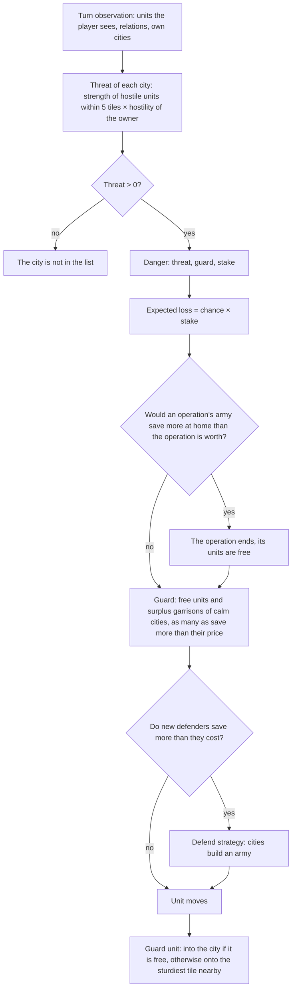

# AI defence: cities under threat

> Variant names in the records are by their meaning on the day of the record; `standard` between the promotions is the current `allocator`, `baseline` is `legacy`. The correspondence table, the current `standard` and the status of the goals are in [ai.md](ai.md), sections 3–4. State of the document: October 16–19, 2026.

Step 6 "defence" of the section "M6.2. The whole AI" ([ai.md](ai.md)). The AI variant `defence` (`classic_rules::ai::variant`, code in
`ai/defence.rs`) is `leaders` (classic/docs/ai-leaders.md) that values holding its own cities to the same degree as
everything else: in points of the final score, and for an original capital also the chance to win × the prize. `leaders` and `standard` do
not change: defence lives in the turn brief only for `defence`.

**Result (October 16, after the merge of `main` 2f614c3: peace by value, the leaders' taste).** Against an attacking
`operations`, `defence` loses a quarter fewer cities than `leaders` on the same seeds: 43 against 58 over
800 games (0.054 and 0.073 per game), original capitals 0 against 2, the attacker takes a city in 6.1% of wars against
7.5%; the difference in cities is about 1.5 σ by Poisson, a direction rather than a proof. Against `leaders` in the same
games it is 27 against 27, capitals 0 against 1: with peace by value, wars between leaders last 8–9 rounds, and cities
are rarely lost by either. Strength against `leaders` is **49.8%** (bootstrap over 40 seed blocks 47.2–52.1%, "no difference
visible"; paired score difference −1.5, −9.3…+6.0); against `operations` 69.2%, the same as `leaders` (69.3%). The decisive
part is production: a city under threat puts a defender or walls first when they pay off
("Production"); without this (before the fix) the losses were the same as for `leaders`. `standard` is the same move for move
(the `ai_rounds` counters are equal), a `defence` round is 8–17% longer than for `leaders`.

## What was wrong

Probes of the bench (`leaders` and early versions of `defence` against `operations` and `leaders`, 80 games each; for every
lost city, an observation of the defender 25 rounds before the loss):

- cities are lost late (rounds 150–296), more often new border ones (1–4 citizens);
- the attacker's army is 5–13 units within 3 tiles of the city; the defender has 0–8 nearby, there are often no garrisons; in half
  of the cases the empire has no free units at all (the army is 4–9 units for the whole empire, the economy does not sustain it);
- the attacker's army stands at our border in peacetime for 5–20 rounds before the declaration of war (strength 16 → 93 at one
  city): that is the warning; `leaders` does not see it: for it a threat is only the units of those it is at war with;
- between the first visible threat during a war and the loss there are 4–8 rounds: production cannot keep up.

## Model

- **Danger** (`Danger`) is one of the player's own cities near which (`THREAT_RADIUS` = 5, the threat radius of the planners) the player
  sees military units with nonzero hostility:
  - **threat** is their strength (strength × health, an AI measure), each one by the hostility of its owner;
  - **guard** is the strength of the city itself (its strength as estimated by the attacker, `operations::estimate_city`, × health) and
    of its own military units within 2 tiles (`GUARD_RADIUS`); the **guard plan** is the city and the units with the `Defend`
    task for this city, wherever they are (those on their way too);
  - **stake** is what the loss costs: the city's value in score points, the same measure by which operations value a capture
    (`operations::city_worth`: the points of the city, tiles and citizens, its income to the end and half of the points that
    the rival gets); for an **original capital** also its share of the game: the chance of a time victory × the prize
    (`grand_strategy`) / the number of original capitals that the attacker still lacks, the whole game if ours is
    the last (the attacker wins by domination).
- **Hostility** (`hostility`): war is 100%; peace with one who has lost trust (a recent war, denunciation,
  the reputation of an aggressor, `diplomacy::trusted`) is 100%; peace with another nation is 50% (`STRANGER_PERCENT`):
  its army at our border is a warning; a defensive alliance and city-states are 0. In peacetime only
  units in the field count: the garrison of a foreign city guards its own city.
- **The chance of losing a city** (`chance`) is the ratio of threat to guard to the fourth power: equal forces are 50%, a threat
  twice as large is 94%, twice as small is 6%. The siege model of operations takes a city in its own rounds with about double
  the city's strength (a 200 HP city heals 20 and hits back); a raid by several units almost never takes
  a city with a guard.
- **Expected loss** is chance × stake.

## Responses: each is valued by the loss it saves

One owner: everything is decided at the start of the player's turn (`defence::respond` from `ClassicMind::start_turn`, where the
observation is available), before operations; unit moves only read the brief.

| Response | When | Price |
|---|---|---|
| **Recall an operation** (`recall`) | the operation's army (its strength) would save more at the most dangerous place than the operation is still worth (`operations::running_value`: the value of a war with an already assembled army for the remaining rounds of the phase, and the siege) | the operation ends, its units are free and go into the guard |
| **Guard** (`assign`) | units that arrive within `RESPONSE_ROUNDS` = 4 rounds (the time a front siege takes a city): free ones (`operations::free_units`) and the garrisons of calm cities, except the first one in each; the greatest danger first, the nearest units first, as many as give the greatest saved loss above their own price (`Danger::best_count`) | a unit's price is its hammers at the production price; a withdrawn garrison is built again by the city |
| **Arming** (`arm`) | new units of the best available melee type save more than they cost, on top of the guard sent and the military units already in queues (up to double the threat) | hammers and upkeep to the end of the game; the Defend strategy, which production already reads (`planner_cities`: the army before the allocator's choice), until the next survey; the strategy survey does not know about it, so after it `arm` is called again |
| **Defender or walls first** (`planner_cities::defence_orders`) | in a city under threat, new defenders pay off (`defence::defender_net`: the best prefix, the benefit per unit) or a building that strengthens the city itself saves more than it costs (`defence::building_net`) and is built within `RESPONSE_ROUNDS` or bought; the best by benefit | the queue is cleared, the order goes first, the former head goes after it; purchase when the treasury keeps `HURRY_RESERVE` |
| **Guard unit's post** (`guard_step`) | a unit with the `Defend` task for a city in danger | into the city if the tile is free; otherwise onto a tile near the city reachable in one turn, with the best ground defence (hills, mountains, forest, `combat::terrain::ground_defense_percent` on the known tile), with fewer enemies nearby |

One estimate decides "how many": several units against a threat much larger than the guard save the city, one saves almost
nothing; so the number of guards and defenders is the maximum of "saved loss − their price" over a prefix of the nearest, not
a threshold of one. There are no hard unit numbers: the need is derived from the threat.

Strikes stay as before: the city strikes by itself (`combat::city_strikes`), a guard unit near the enemy decides as `leaders` does
(`tactics::immediate`: a ranged unit shoots, melee hits a weak neighbor, one wounded below 35 HP retreats into the city).
The guard is not removed from its duty by a garrison surplus (`planner_units::surplus_defender`), nor by recruitment into an operation
(`operations::free_units`).

## Production: defender or walls first

The allocator (`allocator.rs`, `value.rs`) is untouched. The Defend strategy fills only the **free** slots
of the queues of all cities and does not clear the full queue of the threatened one; in the 4–8 rounds of a war a defender there almost never
appeared. So for `defence` (the other variants have no danger list, and the function exits at once) a city under
threat itself puts first what saves it now (`planner_cities::defence_orders`, next to the former
emergency need `defend_now`):

- **defender**: the best available fighter; the value is the benefit per unit of the best number of new defenders on top of the
  guard sent and the military units in queues (`defence::defender_net`), the price is the hammers at the production price
  and upkeep to the end;
- **walls**: any building that strengthens the city itself (the city's `ModifyCityCombat`: strength, hit points;
  `defence::city_defense`); the value is the loss that the increase of the city's strength (strength × health) saves from
  this threat, minus hammers and upkeep (`defence::building_net`); only if the city builds it within
  `RESPONSE_ROUNDS` or can buy it now;
- the best by benefit is taken; the queue is cleared, the order goes first, the former head goes after it; the order is bought
  when the treasury keeps `HURRY_RESERVE` (the same calculation as for `defend_now`). If the head of the queue is already a fighter or
  such a building, nothing changes.

The city's strength in the danger model now takes its own walls into account (we know them); the walls of the other
variants are still valued by the allocator with the `military` weight without a threat.

Before this fix (the first version of the branch, `main` 05fb1b9) `defence` against `leaders` lost 41 cities against 39 over 800
games, against `operations` 46 against 43; the same fix in a measurement outside the branch on that `main` gave against
`leaders` 27 against 52 and against `operations` 42 against 43.

## AI memory and saves

There is no new memory: dangers are computed every turn from the observation, a guard is an ordinary `Defend` task. The save
format is the same.

## Measurements

October 16, Apple M4 Max, `--jobs 3`, the machine was shared with other agents (load average 75–230). The `standard` bench
(80 games of 300 rounds per run), `--repeat 10`: offsets 0–9, 40 seed blocks. The intervals are a bootstrap over
seed blocks (`bench/paired-bootstrap`, not yet in `main`: the measurement was assembled locally from `ai/defence` + this branch).
The code is `ai/defence` at 5c3b855 (73b4a1e plays the same games: the hash at offset 0 matched).

### Strength and city losses (800 games per series)

| Series | Point share (bootstrap) | Cities lost | Original capitals | Wars of the side · attacker took a city |
|---|---|---|---|---|
| `defence` against `leaders` | **49.8%** (47.2–52.1), no difference visible; score −1.5 (−9.3…+6.0) | 27 · `leaders` 27 | 0 · 1 | 377 · 25 (6.6%) against 372 · 27 (7.3%) |
| before: `leaders` against `operations` | 69.3% (66.4–72.1) | **58** (0.073 per game) | **2** | 724 · 54 (7.5%) |
| after: `defence` against `operations` | 69.2% (66.6–71.9); score +91.6 against +89.9 for `leaders` | **43** (0.054 per game) | **0** | 686 · 42 (6.1%) |

"Wars of the side", since 2f614c3, count only wars between nations at the seats (the bench's war model in `main`). With peace by
value wars are short: the average length is 8.2–9.5 rounds, peace by deal in 87% of the leaders' wars.

### First version (before the production fix, `main` 05fb1b9, Wilson, preliminary)

| Run | `defence` share of victories | Cities captured / lost (`defence` · opponent) | Original capitals lost | Wars declared on the side · of them the attacker took a city |
|---|---|---|---|---|
| against `leaders`, offsets 0–4 | 196 of 400 = **49.0%** (44.1–53.9), by runs 47.5 / 50.0 / 52.5 / 50.0 / 45.0 | 21 / 17 · 24 / 25 | 0 · 2 | 271 · 17 (6.3%) against 287 · 20 (7.0%) |
| against `leaders`, offsets 10–14 | 199 of 400 = **49.8%** (44.9–54.6) | 16 / 24 · 22 / 14 | 0 · 1 | 263 · 21 (8.0%) against 293 · 13 (4.4%) |
| together | 395 of 800 = **49.4%** (45.9–52.8) | 37 / 41 · 46 / 39 | 0 · 3 | 534 · 38 (7.1%) against 580 · 33 (5.7%) |
| `leaders` / `defence` against `operations`, offsets 0–4 | 67.1% / 67.0% | 43 / 46 | 0 / 0 | 6.3% / 6.7% |

### Time

`ai_rounds 3 8 2 representative` (three alternations of `main` 2f614c3 / the branch): `standard` round median 20.0 /
20.5 / 14.1 ms on `main` and 13.8 / 14.2 / 13.9 ms on the branch, the work counters are equal: the same games.
`AI_VARIANT=leaders` 14.9–16.1 ms, `AI_VARIANT=defence` 17.4–17.8 ms (+8–17%: the guard, the guard unit's post, the choice of
defender). The first versions were slower: the victory screen (the score of all nations) for every danger — 81–86 ms;
the best fighter type for every city and a check of all buildings — 24–25 ms.

## What was tried

The suite is `defence` against `operations` or `leaders`, 80 games per run unless said otherwise; losses are the
cities lost by the `defence` side (for `leaders` on the same seeds, in parentheses).

| Version | Change | Cities lost |
|---|---|---|
| v1 | chance by the square of the strength ratio, the guard only from free units, Defend when one defender pays off | against `operations` (offset 0): 8 (10); against `leaders`: 6 (4), share 50.6%, military strength +24% at round 100, score at the end −22 |
| v2 | + the guard unit's post on sturdy ground, guard units are front participants (they hit only from their place) | against `operations` (offset 1): 14 (12) |
| v3 | chance by the fourth power, garrisons of calm cities in the guard, units in queues counted | 8 (12) |
| v4 | the number of guards and defenders is the best prefix (`best_count`), not a threshold of one | 7 (12) |
| v5 | an army in the field at the border in peacetime is a threat (distrust 100%, otherwise 50%, friends 0) | 9 (12); against `leaders` (offset 0): 8 (4) |
| v6 | friends are also 50%, the first garrison of a calm city stays | against `leaders`, 400 games: 32 (20), share 49.1% |
| v6 without one part (front, Defend, post, guard), offsets 0 and 3 | — | together 37 (38) over 640 games |
| first version of the branch | v6, guard units do not join the front (they hit by `tactics::immediate`, as `leaders` does) | against `leaders` 41 (39) over 800; against `operations` 46 (43 for `leaders` on the same seeds) |
| measurement outside the branch | + a defender first in the queue of a threatened city | against `leaders` 27 (52) over 800, share 50.4%; against `operations` 42 (43) over 400 |
| **result** | + walls against the same threat, the city's strength with its own walls; after the merge of `main` 2f614c3 (peace by value) | against `leaders` 27 (27) over 800, share 49.8%; against `operations` 43 (58 for `leaders`) over 800 |

The probe of v3–v6 (an observation of the defender 25 rounds before every loss) showed that the danger is seen in time:
an army at the border in peacetime 5–20 rounds ahead, during a war 4–8; but the guard hardly grows (the guard plan is
unchanged in 7 of 9 losses): there are no free units within reach, and Defend gives a defender into a free slot of
the queue, which a full queue does not have; the guard melts (strength 46 → 32, 165 → 74) while the attackers are 60–150.
A front for the guard (strikes by a kill plan, only favorable trades) made it more passive than the strikes of
`tactics::immediate` (`leaders` kills more units), so it was removed.

## What limits it

1. **The army nearby, not the decisions.** A city is lost by an empire that has no units near it and no free ones either:
   the allocator (step 4) does not keep an army beyond garrisons; defence rearranges what exists and builds
   a defender or walls only in the threatened city.
2. **Defend stops its own wars.** While danger holds the strategy, operations do not start: against
   `operations` `defence` took 19 cities against 33 for `leaders`; in the share of victories and the score this is not visible (69.2% and
   69.3%), but the warlike leaders of `defence` fight less.
3. **Rare events.** A city is lost in 3–7 games out of 100; a difference of a quarter is visible only over thousands of games
   (43 against 58 is about 1.5 σ). A suite with more attacks (armies sent to capture, `duel`) would answer faster.
4. **Peace by value itself reduces losses.** After the merge, wars between leaders end with a deal in 8–9
   rounds; against `leaders` the losses of both sides are 27 each over 800 games, and defence gives no difference there.

## What next

- Against the armies of `operations`, defence reduces losses by a quarter; their army at the border is visible 5–20 rounds ahead, but
  the guard and defenders do not catch up with its strength in that time. The next lever: a strike at the assembling army or peace before
  its advance (the same measure: peace that removes danger from a capital is worth its stake).
- Walls against a threat exist only for `defence` (in its production need); the allocator of the other variants values
  them without a threat; the decision is up to the owner of the allocator.
- A bench suite "attack" with a large number of sieges, to measure defence on hundreds of losses rather than dozens.
