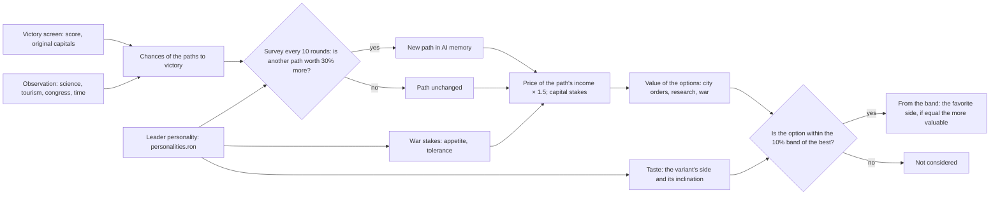
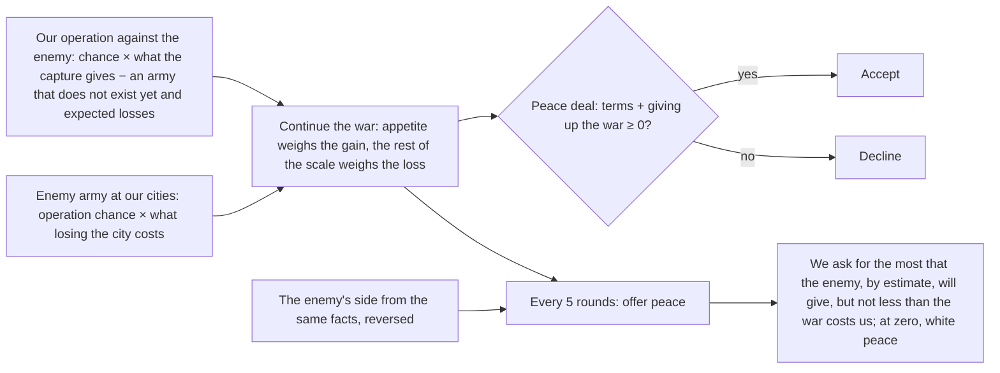
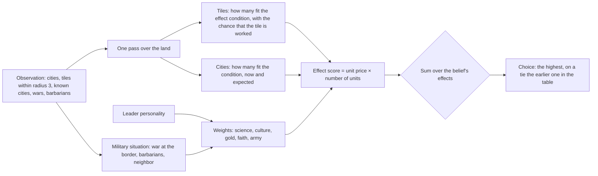

# AI leaders: personalities and grand strategy

> Variant names in the records are by their meaning on the day of the record; `standard` between the promotions is the current `allocator`, `baseline` is `legacy`. The correspondence table, the current `standard` and the status of the goals are in [ai.md](ai.md), sections 3–4. State of the document: October 16–19, 2026.

Step 5 of the section "M6.2. The whole AI" ([ai.md](ai.md)). The AI variant `leaders` (`classic_rules::ai::variant`, code in
`ai/grand_strategy.rs`) is `standard` (classic/docs/ai-allocator.md) played by the nations' leaders: each
has a personality from data, and the grand strategy leads it to one victory. Since step 6 its wars with
nations end with peace by value (`ai/peace.rs`, section "Peace by value"); `leaders-alone` is
`leaders` without that, its control.

**Promotion (October 16): the leaders are the game AI.** The leaders with defence and econ2 became `standard`: against the former game AI
(`allocator`) at the new offsets 70–74, 61.8% (56.2–67.2%) on standard and 50.0% (45.5–54.5%) on `duel`
(platform/docs/ai-bench.md, "Game AI — `standard`: leaders with defence and econ2"). Peace by value became two-sided: when the
game AI is on all seats, of 150 wars 137 end with a deal and none by leaving on a timer (for `allocator`, 97 of
114 by leaving); on `duel` wars last 31 rounds instead of 14, 11 cities are captured against 4, but domination is still
a rarity: one in 1,600 games. Below is the record of steps 5–6 before the promotion.

**Result (before the promotion): the game AI stays `standard`; the goal of personalities is variety, not strength.** Since October 16 a personality is
not a shift of prices but a choice among almost equal-value options (`ai/taste.rs`, a band of 10% from the best value).
Not weaker than `standard` (point share, 95% bootstrap CI over seed blocks, the bench method, platform/docs/ai-bench.md
"Statistics"; the version with peace by value, `main` 2f614c3): 48.5% (46.5–50.5%) on the held-out suite
(offsets 10–19, 800 games, 40 blocks), 50.2% (47.5–52.8%) on the tuning suite 0–4, 49.8% (46.8–53.0%) on the
new 60–64, together 49.2% (47.8–50.7%, 80 blocks); on `duel` 48.8% (47.1–50.2%) and 49.8% (47.8–52.0%) —
everywhere "no difference visible"; by score weaker on 10–19 and on `duel` 60–64 (−6.5 and −19 points per seat). Wars are distinguishable: the warlike (aggression ≥ 8) declare 2.5 times
more wars than the same nation under `standard`, the peaceful (≤ 3) half as many; traders (gold ≥ 7)
build more gold buildings. **Wonder builders (wonders ≥ 7) do not build more wonders at any of the
band widths tried (10, 25, 50%)** (on the held-out suite −0.33, interval −0.79…+0.21): wonders are a shared pool, by the end of the game 22–23 of about 27
available are built, and an extra decision "build a wonder" does not win the race. The other economic inclinations
(expansion, science, culture, faith) are not distinguishable on the bench. The price of a personality on the same seeds (offsets 0–4) is
−3 score points per seat against −12 for the inclination prices of step 5 (on the held-out suite −6.8). Neutral leaders play as `standard`, move for move. Round time is within noise. Peace by value (step 6): against its control `leaders-alone` 50.5% (49.5–51.5%) and 50.0% (49.2–50.7%), together 50.2% (49.6–50.9%, 800 games) — neutral; wars are shorter — 9.2 rounds instead of 14.8. Round time +1…+6%. Saves are compatible (AI memory version 4, old ones load). **Finding capitals** (section below): a leader that needs an unfound capital leads scouting toward it, and a capture that wins the game reaches a capital farther than 14 tiles; on `duel` (800 games) the rival's capital is found by 44.8% of seats instead of 39.2%, by round 100 17.2% instead of 10.1%, dominations for `leaders` 2 instead of 1 (measured after the merge with peace by value).

**`standard-econ2` prices** (the record uses the former name, now `allocator-econ2`; step 6, economy; classic/docs/ai-allocator.md, "Gold and happiness"): the variant
`leaders-econ2` is `leaders` with the gold and happiness prices of `standard-econ2`; against `leaders` 62.7% on the
held-out suite (offsets 10–14, 400 games, bootstrap over seed blocks 59.2–66.2%, score +72.9). With
neutral personalities it plays as `standard-econ2` (`allocator-econ2`), move for move, in games without war (the test
`neutral_econ2_leaders_play_the_econ2_allocator`). The taste band did not change.

## Scheme

## Personalities are data

The `personalities` table of the Civ V module (`classic/assets/rules/classic/personalities.ron`): the leader of each of the 43
nations has nine inclinations from 0 to 10, 5 is neutral.

| Inclination | What it changes for the leader |
|---|---|
| `expansion` | a settler in the choice band |
| `wonders` | a world wonder in the choice band; research that opens an unbuilt wonder |
| `science`, `culture`, `gold`, `religion` | a building with science, culture, gold, faith income in the band; research that opens such a building |
| `aggression` | the weight of winning a war (and of losing, inversely); above 5, the weight of the domination path |
| `war_tolerance` | how much the unhappiness of a captured city matters (10 means it does not matter, 0 means twice as much) |
| `diplomacy` | above 5, the weight of the diplomatic path |

Aggression and tolerance change the weight of war by 20% per point in both directions (0–200%; `leaning`, `Stakes::weigh`):
the decision about war is a threshold (the operation's value above zero), not a choice from a ranked list, so the band
is not applied to it. A neutral personality (`Personality::NEUTRAL`, 5 everywhere) changes no choice and is not
inclined to any path except the score: it plays as `standard`.

**Source and license.** The values are the project's own judgment based on public descriptions of the leaders and
of their nations' abilities (the name of the ability is in `civilizations.ron`), without game files and without other
people's tables: each row has a `why` field that says what the inclination rests on (Egypt: "Monument Builders:
wonders built faster", wonders 10; the Huns: "Scourge of God", aggression and tolerance 10, wonders 2; India:
"tall cities; Gandhi's non-violence", aggression 1; Venice: "no settlers", expansion 0). `Personalities.json`
from Unciv (MPL-2.0) was not copied: this environment has no network, and our own values do not require a
license notice. The table is written by the importer (`classic/crates/classic-content/src/import/personalities.rs` → `personalities.ron`;
the importer had not been built since the split into a platform, and was fixed), and read by the RON loader and the module compiler
(`classic::tables::ClassicTables::personality`: a nation without a row is neutral, a second row or a value
outside the scale is an error). This is AI data, not a rule: the table is not part of the rules fingerprint, and saves
load with any personalities.

## A choice among equals (the band)

`standard` takes the single best option by value: a city order by value per turn of production
(classic/docs/ai-allocator.md), research by value per beaker. A leader (`ai::taste::pick`) takes, among the options
whose value is no lower than the best by more than `BAND_PERCENT` (10%), the one whose side of the game its personality likes
more; at equal inclination the more valuable, at equal value the earlier in the table order (as `standard`). Outside the
band value decides: a personality never takes a noticeably worse option. The option's side (`Sides`):

| Option | Side |
|---|---|
| settler | expansion |
| world wonder | wonders |
| building | the incomes that its effects add: science, culture, gold, faith (for a library, science; for a mosque, culture and faith) |
| research | the sides of the buildings it opens (a wonder, while no one has built it) |
| worker, other | none: neutral (5) |

The inclination of an option with several sides is the greatest of them. An inclination below neutral works in the
opposite direction: the disliked best yields to a neutral option from the band. For a neutral leader all
inclinations are 5, and the choice matches `standard` (the test `neutral_leaders_play_the_allocator` and the `--ignored`
suite of 80 games).

The band replaced step 5, the price multipliers (`emphasis`: up to 150% of the price of the favorite side and of expansion): they
shifted the measure of the score and cost ≈ 10 points per seat, and did not change the wonder builders. The price of the path's income (× 1.5) and
the war stakes remained.

## The paths to victory in one measure

The allocator's measure is the points of the final score (classic/docs/ai-allocator.md). A path to victory is valued by what it gives
the victory: **the chance to win by this path** (thousandths), and a step toward victory by **the gain in chance × the prize**, where the prize is
the whole score of the game (the best of ours and our rivals' at the last round, each at its current pace; hundredths of
a point). Everything is from the public victory screen (`PlayerQueries::race`: the score of the nations met, the original
capitals and their owners, the coordinates where the player has seen them), the player's observation and the time to the end.

| Path | Chance (`Outlook`) | What it changes in prices |
|---|---|---|
| score (time victory) | our score⁴ / Σ scores⁴ of the known nations; the farther the end of the game, the closer to the equal 1/n | nothing: the `standard` measure |
| domination | the product of the chances of taking each foreign original capital by the end: one operation takes a capital within reach (14 tiles from our city, coordinates known) with a 35% chance, otherwise 15%; attempts: as many operations of 30 rounds as fit | for the rivals' capitals in the value of war: the gain in the chance of domination × the prize |
| science | all unknown technologies of "Apollo" and of the ship parts (with prerequisites) at our science now + 25 rounds of building: if it makes it, from 50% (no margin) to 100% | beaker price × 1.5 |
| culture | all nations met, our tourism catches up with the accumulated culture of each (their growth is their average pace) by the end: from 50% | culture price × 1.5 |
| diplomacy | the UN is in session: 50% × (2 + allied city-states) / the votes needed | gold price × 1.5 |

The value of a path for a leader is the chance × the weight: for the score the weight is 100%, for the others 40% per point of inclination above
neutral (`aggression` is domination, `science`, `culture`, `diplomacy`), 200% at 10; at or below 5, 0.

**Hysteresis.** The path is reviewed every 10 rounds (offset by player number, when the player has a
city); another path replaces the current one only if its value is greater by 30% (`SWITCH_PERCENT`).
The path is kept in AI memory (`kernel::ai::state::Aim`: the path code and the round of choice).

**The winning capture.** A capture after which we hold all the original capitals wins the game: for any
leader, on any path, its value is the prize × (1 − the chance of a time victory), without the city's points and its
unhappiness (after the capture the game is over); the army for it may be assembled for twice as long (60 rounds) from
units within 32 tiles of the gathering point, the target may lie within 32 tiles of our city (not 14), its upkeep is
counted up to the capture, not to the end of the game. This capture and the search for its capital (below) are the only differences between
a neutral leader and `standard`; in games of four or more nations they do not arise until one foreign capital is
left.

## Finding capitals

A capture is led by an operation, and an operation aims only at a city that the player has seen; the domination path values a
capital whose coordinates are known. On `duel` (offset 0) leaders knew the rival's capital in 12% of the estimates
of the capture that wins the game: the scout warrior walked the land near home, wounded units went to heal in the capital
(up to 35 rounds on the road), scouts died near barbarian camps and were not rebuilt while the land within 6 tiles
of the cities was explored, and after round 150 scouting ended. Of the known capitals, three quarters lay
farther than 14 tiles from our nearest city (most often 16–30), out of the operation's reach.

**When a leader searches** (`ai::capital_search`, `CapitalSearch::of`): it needs a capital whose place it does not
know: the last foreign original capital always (its capture wins the game), each one on the domination path, and
the enemy's capital for a leader with aggression above 5 during a war. The source is only the player's knowledge: the victory screen
(`PlayerQueries::original_capitals`: which capitals exist and who owns them, the tile if the player has revealed it) and the
known map (the tiles of the capital's owner that the player has seen). There are no new channels of knowledge.

**What the search changes** (for the other variants and for a leader without a search, everything is as before):

| Where | Without search | With search |
|---|---|---|
| scout target (`planner_units`) | a frontier tile: open tiles × 10 − 4 per move of the path | the same + 10 per tile away from our capital + 150 next to (3 tiles) a known tile of the capital's owner at the edge of the unknown; tiles within 2 of a known barbarian camp are not a target |
| scouting season | until round 150 or while units are sailing | the whole time of the search |
| building a scout (`planner_cities`) | no one is scouting and there is unknown land within 6 tiles of cities | no live or ordered scouting unit (a warrior on a scouting task does not count) |
| wounded scout | goes to heal in the nearest city | heals in place if there is no enemy nearby (3 tiles) |
| winning capture (`operations`) | target within 14 tiles, unit recruitment within 15 tiles of the gathering point, gathering 30 rounds in execution (60 only at choice) | target within 32 tiles (`DECISIVE_RANGE`), recruitment within 32, gathering 60 rounds; the leader's stakes are read during the operation too |

**What was tried.** Duel, offset 0 (80 games): the share of estimates of the winning capture where the capital is known; seats of
`leaders` that found a capital; of them by round 100.

| Version | Change | Known in estimates | Found | By 100 |
|---|---|---:|---:|---:|
| before | `main` | 12.1% | 29 | 5 |
| v1 | scout target: from home and toward the owner's borders | 18.6% | 36 | 10 |
| v2 | + scouting after round 150, a scout is built during the search | 18.6% | 34 | 10 |
| v3 | + a warrior on a scouting task does not replace a scout | 17.5% | 31 | 10 |
| v4 | + barbarian camps, healing in place | 17.3% | 33 | 9 |
| v6 | + winning capture within 32 tiles, recruitment within 32, gathering 60 rounds | 13.0% | 33 | 9 |

For v6 there are fewer "known" estimates because during an operation against a found capital there is no estimate. A comparison
at offsets 0–2 (240 games; the share of seat rounds when the capital is known; found by round 100 out of 240 seats):
`main` 15.0% and 19; **v6 22.2% and 36**; v7 (the target is the mass of the unknown within 6 tiles instead of "from home") 18.9% and
24; v8 (v6 + a scout beyond the army limit) 21.8% and 36. The result is v6: v8 gave nothing extra, v7 is worse.

### Search measurements

October 16, Apple M4 Max, `--jobs 3`, the machine was shared with other agents (load average 130–150). `leaders` against
`standard`; "before" is `main` (553ac73), "after" is this branch; both runs on the same seeds. The share of estimates was measured
by a temporary insertion into `lead` (an estimate is a move without an operation in the season, as in `main`), the rest comes from the bench report
(the "found rival capitals" row) and an analysis of the seats by map.

| duel, offsets 0–9, 800 games | before | after |
|---|---:|---:|
| estimates of the winning capture where the capital is known | 15.1% (offset 0: 12.1%) | 19.1% (offset 0: 13.0%) |
| …and the capital within 14 tiles of our city | 6.2% | 8.1% |
| `leaders` seats that found the rival's capital | 37.4% | 45.5% |
| found by round 100 | 10.0% | 17.8% |
| round of finding: quartile / median / quartile | 95 / 175 / 233 | 29 / 149 / 208 |
| share of seat rounds when the capital is known | 17.3% | 25.0% |
| victories by domination: `leaders` / `standard` | 3 / 1 | 4 / 0 |
| cities captured / lost, wars declared (`leaders`) | 41 / 21, 116 | 51 / 11, 269 |
| `leaders` share of victories against `standard` (Wilson) | 48.6% (45.2–52.1) | 49.5% (46.0–53.0) |

By map (`leaders` seats, found / by round 100 out of 160): pangaea 123 / 38 → 137 / 64, fractal
73 / 19 → 103 / 36, archipelago 48 / 3 → 63 / 8, continents 25 / 16 → 27 / 21, small-continents 30 / 4 →
34 / 13. The "known" estimates are understated after: while an operation against a capital is under way (it is known), there is no estimate.

Standard (offsets 0–4, 400 games): the search turns on rarely (with four to six nations a capital is needed
only by a warlike leader at war or on the domination path); 24.0% of foreign capitals found against 23.9%,
share of victories against `standard` 47.5% (42.7–52.4) against 47.8% (42.9–52.6); no dominations before or
after.

**Strength against the former leaders.** The temporary variant `leaders-old` (the leaders of `main`, only for the measurement, not in the
branch; against `standard` it gives the same result hash as `leaders` on `main`, `47d35f4d39531c68` on duel
offset 0) was seated against the new `leaders` (`--baseline leaders-old`): duel, offsets 0–9 — 399 of 800 =
**49.9% (95% Wilson CI 46.4–53.3%)**, by runs 50.0 / 55.0 / 50.0 / 45.0 / 53.8 / 42.5 / 43.8 / 46.2 /
58.8 / 53.8; standard, offsets 0–9 — 399 of 800 = **49.9% (46.4–53.3%)**, 165 of 200 pairs of games at
offsets 5–9 were played identically (the search did not turn on). Not weaker: the lower bounds are above 45%. The Wilson interval is
preliminary: the paired bootstrap over seed blocks (branch `bench/paired-bootstrap`) has not yet appeared on origin.

**Time.** `ai_rounds 3 8 2 representative`, eight alternations of `main` / the branch (the machine under load, load
average 100–150, spread of the run medians 17–34 ms): `standard` — the minimum of round medians 17.4 ms on `main` and
16.8 ms on the branch, `AI_VARIANT=leaders` — 17.2 and 17.0 ms; the run totals (units, cities) match. The behavior of
`standard` did not change (it has no search, the pinned hashes are the same); for leaders the search costs one pass over the map per turn while it is
on, and reading the victory screen during an operation.

**After the merge with peace by value and the personality band** (`main` 8ebea61, the same measurement on duel, offsets
0–9, 800 games, `leaders` against `standard`; "before" is `leaders` on `main`, "after" is the branch after the merge):

| duel, 800 games | before | after |
|---|---:|---:|
| estimates of the winning capture where the capital is known | 15.6% | 18.5% |
| …and the capital within 14 tiles of our city | 6.9% | 7.8% |
| `leaders` seats that found the rival's capital | 39.2% | 44.8% |
| found by round 100 | 10.1% | 17.2% |
| round of finding: quartile / median / quartile | 98 / 179 / 226 | 29 / 150 / 211 |
| share of seat rounds when the capital is known | 18.0% | 24.5% |
| victories by domination: `leaders` / `standard` | 1 / 0 | 2 / 0 |
| cities captured / lost, wars declared (`leaders`) | 37 / 11, 134 | 52 / 9, 267 |
| of the `leaders` wars: peace by deal / the rival left on its own / goes to the end | 33 / 84 / 17 | 43 / 185 / 38 |
| `leaders` share of victories against `standard` (Wilson) | 48.8% (45.3–52.2) | 48.2% (44.8–51.7) |

Against the former leaders (`leaders-old` — the leaders of `main` 8ebea61, a temporary variant only for the measurement; against
`standard` it gives the same hash as `leaders` on `main`, `6e23f6f9e7c3ca47` at offset 0): duel, offsets 0–9 —
391.5 of 800 = **48.9% (95% Wilson CI 45.5–52.4%)**, by runs 45.0 / 51.2 / 50.0 / 43.8 / 52.5 /
43.8 / 51.2 / 46.2 / 55.6 / 50.0; dominations 2 for the new, 1 for the former. Not weaker (the lower bound ≥ 45%;
Wilson is preliminary, there is no bootstrap on origin).

Peace by value keeps only the leader in the war: the rival on duel is `standard`, and it still leaves the
war on its own after 15 rounds (185 of the 267 wars declared by leaders). The march to the capital breaks off the same way as before the
merge.

**Why dominations barely increased.** Operations for the winning capture now start and set out (duel,
offset 2: 30 started, 19 set out), but of the 17 that ended on the march 12 ended with a peace that the rival
concluded after 15 rounds of war (peace is one-sided, classic/docs/ai-operations.md "What limits it" item 3), another 5 by
the march limit or the weakness of the army at the target. Finding the capital now succeeds more often; taking it within 15 rounds of the declaration does not.

## Peace by value (step 6)

**Result: peace for `leaders` is now two-sided and by value.** A leader ends a war with a nation only
through a peace deal (`ai/peace.rs`, `PeaceMaking::ByDeal`), and by itself (`MakePeace`) only with city-states.
Each side accepts peace when continuing the war costs it less than the terms; the terms (gold and cities)
are valued in the allocator's measure, not by numbers in the code. The former `leaders` and `standard` left a war by themselves
after 15 rounds if no operation was conducting it: in these rules `MakePeace` does not ask for consent, whereas in Civ V
peace between nations is a deal accepted by both (classic/docs/classic/rules.md). `standard` did not change.

**What a war costs** (`WarProspect`, hundredths of a score point):

- **gain**: an operation already under way against this enemy (`operations::running_case`): the chance of taking a
  city (`SUCCESS_PERCENT`, 35%) × what the capture gives (the city's points, its income to the end, half of the points
  that the rival loses, minus unhappiness; for an original capital its share of victory; for a winning capture,
  the victory itself), minus the army that does not exist yet and expected losses; without an operation, 0;
- **loss**: the enemy's army seen near our cities (its strength in AI memory) takes our city nearest to it with
  the same operation chance, lower when we have more units at the city (chance × the enemy's strength / the strength of ours); the city
  is worth its points, its income to the end and half of the points that the enemy will get (`operations::city_worth`);
- the personality changes only the weight: appetite (aggression) weighs the gain, the rest of the scale weighs the loss
  (`Stakes::weigh`, as in the value of war of step 5); there are no new personality constants.

**Terms.** Gold at the allocator's gold price (a gold coin now = the price of a coin per turn / the remaining
rounds), gold per turn over the term of the deal, a city at its value (our own, `city_worth`; a foreign one, what a
capture without a fight would bring), the rest on the advisor's former gold scale, converted at the same price. Peace in a deal
is worth minus the value of the war. The deal is accepted if the sum is ≥ 0; so are any deals during a war.

**The offer.** Every 5 rounds (offset by player number) a leader at war with a nation from which there is no
offer awaiting an answer offers peace. It estimates the enemy's side from the same facts, reversed: our
loss is its gain, our gain is its loss (it does not know the enemy's army or personality). It asks for
`max(its own value of the war, −the estimate of the enemy's side)`: above zero, gold from the enemy (if the enemy does not have that much,
per the deal screen, `PlayerQueries::offer_problem`, half as much until the terms are no dearer than the war), below
zero, our gold (no more than the treasury), zero, white peace. A hopeless or empty war (value ≤ 0 for
both) ends with a white peace at the very first offer, without a timer.

**What the leader knows.** Only its own: observation, AI memory (the enemy's strength at its cities, the cities seen,
its own operations), the public victory screen (capital stakes) and deal screen checks (whether the enemy has enough gold).

### Measurements

October 16, Apple M4 Max, `--jobs 3`; the machine was shared with other agents (load average 130–280). The main
(offsets 0–4) and held-out (10–14) standard suites, 400 games each; tuning at offset 20. "Before" is
`leaders` on `origin/main` (553ac73, its hashes repeated: 47.8% and 47.0%), "after" is this branch.
The statistics below in the "Strength" table are a recomputation by the bench (bootstrap over seed blocks, platform/docs/ai-bench.md); the earlier
preliminary numbers of this branch used the Wilson interval, with "was" in parentheses. Wars and offers come from the bench's war table and the
`peace_ledger` example (the same games and hashes as in `ai-tournament`).

**Strength.**

| Run | Main (0–4) | Held-out (10–14) | Together (800) |
|---|---|---|---|
| `leaders` against `leaders-alone`, `main` (band and peace) | 50.5% (49.5–51.5); score +1.9 (+0.5…+3.4) | 50.0% (49.2–50.7); score +1.3 (−0.7…+3.4) | **50.2% (49.6–50.9)** |
| was: `leaders` against `leaders-alone` on the peace branch (without the band), Wilson | 49.5% (44.6–54.4) | 49.8% (44.9–54.6) | 49.6% (46.2–53.1) |
| `leaders` against `standard`, `main` (band and peace) | 50.2% (47.5–52.8) | 47.0% (43.5–50.5) | 48.6% (46.4–50.7) |
| was: `leaders` against `standard`, the peace branch (without the band), Wilson; this version no longer exists | 47.2% (42.4–52.1) | 46.5% (41.7–51.4) | 46.9% (43.4–50.3) |
| `leaders` against `standard`, before peace (step 5, 553ac73) | 47.8% (44.8–51.0) | 47.0% (43.5–50.5) | 47.4% (44.9–49.8) |

Peace by value is neutral by itself: against its control 50.2% (49.6–50.9%), design effect 0.02–0.04 —
almost all games are identical, only games with a war diverge; the paired score difference is +1…+2 points per seat.

**Wars** (declared by the side; 800 games against `standard`; "duration" is the average, wars to the end of the
game count up to it):

| | Wars | Peace by deal | Peace alone | Elimination | To the end of the game | Duration, rounds |
|---|---:|---:|---:|---:|---:|---:|
| declared by `leaders`, before | 390 | 0 | 345 | 0 | 45 | 14.8 |
| declared by `leaders`, after | 424 | 316 | 68 | 1 | 39 | **9.2** |
| declared by `standard`, before | 301 | 0 | 255 | 0 | 46 | 14.5 |
| declared by `standard`, after | 314 | 171 | 109 | 0 | 34 | **10.0** |

"Alone" after is `standard`: it still leaves a war by itself; a leader with a nation never does.
Against `leaders-alone` (800 games) the `leaders` wars last 9.3 rounds (312 by deal of 399), its control's
10.5 (207 by deal of 410). Cities captured: against `standard` 48 and lost 28 (before — 53 and 30); against the control
36 and 42 (the control — 57 and 46).

**Peace offers** (800 games against `standard`, gold is a median, value is a median, hundredths of a point):

| Who | What | Number | Accepted | Declined | Gold | Value of the war for the responder: accepted / declined |
|---|---|---:|---:|---:|---:|---|
| `leaders` offer | pay gold | 616 | | | 201 | the offerer's value of the war −2,371 |
| | white peace | 440 | | | 0 | 0 |
| | ask for gold | 59 | | | 143 | −308 |
| `leaders` respond to `leaders` | receive gold | 303 | 136 | 167 | 206 | −1,230 / **+3,322** |
| | white peace | 90 | 71 | 19 | 0 | 0 / +2,164 |
| | pay gold | 14 | 8 | 6 | 167 | −2,784 / −182 |
| `standard` responds to `leaders` | receives gold | 342 | 222 | 120 | 191 | (`standard` does not value it: peace after 5 rounds of war, gold ≤ 100) |
| | white peace | 221 | 143 | 78 | 0 | |
| | pays gold | 44 | 13 | 31 | 124 | |

A leader declines peace while its war is worth something (median +33 points: an operation is under way), and accepts when
it is worth less than the terms (median −12 points). The victim buys peace: about 200 gold on average.
A recomputation of the values by the example after the turn differs from the leader's given answer in 5 of 407 cases (the operation
ended in the same turn).

**Time.** `ai_rounds 3 8 2 representative` under load of 110–280: the wall time is indistinguishable (medians of one
build range from 16 to 220 ms between runs), so the CPU time of the whole run was compared (four
alternations before/after): `standard` 1.33 → 1.31 s, `leaders` 1.34 → 1.35 s (+1%, within the spread of
±0.05 s). The price of peace is the stakes and the value of war, only when a leader is at war with a nation and there is an offer
or a round of offers.

### What limits peace

1. **`standard` does not value peace:** it accepts any peace after 5 rounds of war if it gives up no more than 100
   gold, and leaves the war on its own after 15. So against it a victim leader overpays (about 200 gold
   where a white peace would have been enough), and an aggressor leader does not hold on to a `standard` victim. Two-sided peace
   works fully only when both sides are `leaders`.
2. **Sieges did not get longer.** Wars are shorter (9 rounds instead of 15): the victim buys peace sooner than it
   used to leave on its own; the aggressor refuses peace while an operation is under way, but operations are still short
   (classic/docs/ai-operations.md).
3. **The estimate of the enemy's side is crude:** the leader does not know the enemy's army or personality, so it offers based on the facts near
   its own cities; there is no haggling (raising the price after a refusal) — that would require a memory of past offers.
4. **Losing its own capital** counts as losing a city: the share of victory it gives the enemy is not included in the value
   of the war for the victim.

## Embassies and city-state land (October 16)

**Result: rivals' capitals are now known twice as often, and AI strength did not change.** Two Civ V behavior
rules (classic/docs/classic/rules.md): an embassy shows its owner the host's capital and the tiles
within radius 2, and units of any nation enter city-state land without open borders. `leaders`
value an embassy by the allocator's measure and ask for it themselves.

**Embassy value** (`Stakes::finding`, `Negotiation::found`). Next to the known capitals, `Stakes` holds
those the leader values but has not found (`unfound`): a rival's last capital always, all of them on the
path to domination. Their victory share is the same as for found ones. A received embassy is worth that stake ×
`FAR_CAPITAL_CHANCE` (15%: the chance of one operation taking a far capital), if the host still holds its original
capital: the palace is there, and the embassy will reveal it. On top of that comes the advisor's earlier gold scale (the treaties the
embassy unlocks, and trust), priced in gold. Once every 5 rounds the leader asks such a
nation for an embassy, together with its own if it has none, when the deal is profitable for it and the deal screen lets it through
(`peace::embassy_offers`). Trust is not required for this; the partner decides for itself. `standard` stayed on the gold scale:
it trades embassies only with those it trusts.

**Measurements.** October 16, Apple M4 Max, `--jobs 3`, the machine was shared with other agents (load average 70–100).
"Before" is origin/main `2cc7175`, "after" is `rules/embassies`. The sets and offsets were recorded before the run:
standard — offsets 0–4 (20 seed blocks), duel — 0–2 (24 blocks); intervals are a bootstrap over seed blocks.

| What | Before | After |
|---|---|---|
| Rival capitals found, standard, `leaders` vs `standard` (4,200 "place — capital" pairs per side) | 24% / 24%, by round 100 6%, median — round 175 | 53% / 52%, by round 100 26%, median — round 100 |
| Same, duel (240 pairs) | `leaders` 43%, `standard` 31%; by round 100 15% and 7% | both 65%; by round 100 35% |
| `--solo standard`, standard (840 pairs) | 27%, by round 100 7% | 56%, by round 100 30% |
| `leaders` vs `standard`, standard | 50.0% (47.2–52.5) | 49.0% (46.8–51.5), score difference −1.2 (−9.1…+7.2) |
| `leaders` vs `standard`, duel | 47.5% (42.5–52.5) | 46.2% (41.7–50.8), score difference −33.7 (−81.6…+15.1) |
| `--solo standard`, standard: final score, core rejections | 669.6; 0.62% | 672.7 (+3.0 ± 48.4); 0.34% |

Embassies change both sides at once, so the capital-search advantage of `leaders` on duel (43% vs 31%)
disappears: both sides find 65%. No difference in strength is visible, neither for `leaders` vs `standard` nor for
`standard` vs its former self (the score is within noise). Victories are still almost all by time. `standard` has almost
half as many core rejections; the probable reason (not verified) is that moves across city-state land
are no longer rejected.

**City-state land and the AI.** The AI's pathfinding over the known map (`PlayerView::known_step_cost`) and
observation (`Relation::they_grant_entry`) read the same rule as the core (`territory::lets_in`). Paths go
through city-state land instead of around it; missionaries and archaeologists take targets in their cities. War with a
city-state is no longer needed to pass through, and peace with it does not expel units from its land. There is no influence
penalty for units on its land.

## AI memory and saves

Paths are a new part of AI memory (`Aim`), version 4 (after the war plans). The memory is written in the oldest
version that can hold it: without paths, versions 1–3 are byte for byte as before. Tests: the bytes of versions 3 and 4
(`persistence::codec::ai`), version selection (`persistence::ai`), a game of four `leaders`, saved with
paths into bytes, plays 10 rounds after loading with the same hashes and the same memory; a `standard` save
(without paths, old version) loads under `leaders` and keeps playing — each leader picks a path at the nearest
review (`leaders_aims_survive_save_and_load`).

## Measurements

October 16, Apple M4 Max, `--jobs 3–4`; the machine was shared with up to seven agents (load average 40–130), so timings are
a rough guide. The `standard` bench (80 games of 300 rounds per run), comparing `leaders` vs `standard`.

**How it was measured.** The resampling unit is a seed block: all games of one seed (all maps, both seatings) —
the seed chooses the nations of the game, so the games of a block are linked (the same method is the bench's main metric,
platform/docs/ai-bench.md "Statistics"; the intervals in this section were computed by an analysis script over the JSON reports before the
bench began computing them itself, with Wilson by game alongside. The script and the bench agree: the row of step 5 below,
44.8–51.0%, is the same to the tenth as the bench's on the same games). Distinguishability is paired: a nation sits in the same
seat in both seatings of the map and seed, so the difference "the same seat under `leaders` minus under `standard`"
compares the versions from the same start; the mean of the differences over a personality group and its 95% interval are a bootstrap
over seed blocks (10,000 resamples). **"Clear" was defined before the measurements:** the interval of the difference does not contain 0 and
lies in the expected direction. The report's match rows carry the outcome of each seat (score, cities, founded cities,
technologies, wonders, incomes, buildings by side, combat) — the difference is computed from them.

**Series plan (before the measurements):** the band-width curve — 10, 25 and 50% on offsets 0–4 (400 games, 20 blocks
each), the reference — step 5 (inclination prices) on offsets 0–9; the chosen width — on held-out offsets
10–19 (800 games, 40 blocks), on which nothing was tuned.

### Band-width curve (offsets 0–4)

| Variant | `leaders` win share | Block bootstrap | Wilson | Score per seat, difference | Wars, warlike | Wars, peaceful | Wonders, builders (≥ 7) | Wonders, wonder-averse (≤ 3) |
|---|---:|---|---|---:|---:|---:|---:|---:|
| step 5: inclination prices | 47.8% | 44.8–51.0 | 42.9–52.6 | −12.0 | **+0.24** | −0.02 | −0.09 | −0.41 |
| **band 10%** | **50.0%** | 47.2–52.5 | 45.1–54.9 | −3.0 | **+0.26** | **−0.08** | +0.03 | +0.08 |
| band 25% | 49.0% | 46.5–51.5 | 44.1–53.9 | −7.1 | **+0.21** | −0.06 | +0.16 | −0.61 |
| band 50% | 43.5% | 40.0–46.8 | 38.7–48.4 | −22.9 | **+0.31** | −0.05 | +0.29 | **−1.11** |
| band 50% only for the favorite, width by inclination strength | 47.0% | 43.0–51.2 | 42.2–51.9 | −13.2 | **+0.34** | +0.02 | −0.03 | −0.45 |

Bold marks a clear difference. The wider the band, the more points it costs and the less distinguishable the result: wonder builders do not build more wonders
at any width, at 50% only the "wonder-averse" pass (fewer wonders) and the strength criterion fails.
The 10% band was chosen: `standard` strength, distinguishable wars.

### Strength (band 10%)

| Set | Games | `leaders` win share | Block bootstrap | Wilson |
|---|---:|---:|---|---|
| held-out, offsets 10–19 | 800 | 48.4% | **46.5–50.2** | 44.9–51.8 |
| tuning and held-out together (0–4, 10–19) | 1,200 | 48.9% | 47.3–50.4 | 46.1–51.7 |
| for comparison: step 5, offsets 0–9 | 800 | 49.6% | 47.2–52.1 | 46.2–53.1 |
| **bench, band 10% and peace by value** (`main` 2f614c3), offsets 0–4 | 400 | 50.2% | 47.5–52.8 | — |
| same, held-out 10–19 | 800 | 48.5% | **46.5–50.5** | — |
| same, new 60–64 | 400 | 49.8% | 46.8–53.0 | — |
| same, `duel` 0–9 and 60–64 | 800 + 400 | 48.8% and 49.8% | 47.1–50.2 and 47.8–52.0 | — |

The first three rows are the version before peace by value (analysis script); the last ones are the bench on the `main` version with peace
(paired score difference: −3.2, −6.5, −6.6 points per seat on `standard`, −9.1 and −19.1 on `duel`; below zero — on
10–19 and `duel` 60–64). The bench verdict on all sets is "no difference visible".

The lower bound of the bootstrap is above 45% on both sets; by Wilson on the held-out set it is 44.9% (the Wilson by game
is wider here than the block one: the link between the games of a block is cancelled out by the paired seating). All victories are by time.

### How the leaders differ (band 10%, held-out set, 800 games)

Means per seat: `leaders` / the same nation at the same start under `standard`; the difference and its interval.

| Leaders | Measure | Pairs | `leaders` / `standard` | Difference (95%) | Clear |
|---|---|---:|---|---|---|
| warlike (aggression ≥ 8) | wars declared | 290 | 0.33 / 0.13 | +0.20 (+0.11…+0.30) | yes |
| | cities taken | 290 | 0.04 / 0.02 | +0.02 (−0.01…+0.06) | no (together with set 0–4: +0.04, +0.01…+0.08 — yes) |
| peaceful (aggression ≤ 3) | wars declared | 285 | 0.08 / 0.15 | −0.07 (−0.12…−0.02) | yes |
| builders (wonders ≥ 7) | wonders | 130 | 4.75 / 5.08 | −0.33 (−0.79…+0.21) | **no** |
| dislike wonders (≤ 3) | wonders | 70 | 4.50 / 5.19 | −0.69 (−1.20…−0.25) | yes |
| expansion ≥ 7 | cities founded | 570 | 7.04 / 7.20 | −0.16 (−0.28…−0.04) | no (opposite direction) |
| expansion ≤ 3 | cities founded | 110 | 3.95 / 3.95 | −0.01 (−0.25…+0.25) | no |
| scholars (science ≥ 7) | technologies | 315 | 33.9 / 34.0 | −0.10 (−0.27…+0.07) | no |
| | science buildings | 315 | 1.99 / 1.93 | +0.06 (−0.04…+0.17) | no |
| culture ≥ 7 | culture per turn | 250 | 30.8 / 31.9 | −1.1 (−2.3…+0.3) | no |
| | culture buildings | 250 | 6.00 / 6.16 | −0.16 (−0.30…−0.01) | no (opposite direction) |
| traders (gold ≥ 7) | gold per turn | 470 | 17.6 / 16.9 | +0.6 (−1.5…+2.8) | no |
| | gold buildings | 470 | 4.13 / 3.84 | +0.28 (+0.14…+0.42) | yes |
| faith ≥ 7 | faith per turn | 350 | 8.3 / 9.2 | −0.9 (−1.6…−0.2) | no (opposite direction) |
| | faith buildings | 350 | 1.62 / 1.67 | −0.05 (−0.12…+0.02) | no |
| war tolerance ≥ 8 | cities taken | 205 | 0.03 / 0.02 | +0.01 (−0.02…+0.06) | no (together with 0–4: +0.05 — yes) |
| all | score | 2,000 | 688 / 695 | −6.8 (−12.4…−1.3) | |

Diplomacy has no distinguishable measure on the bench: it changes only the choice of the diplomatic path, and the UN does not
convene by round 300.

**Why wonders do not move.** The selection probe (band 25%, offset 30, 80 games): of 9,644 leader orders, the band
changed 480 (5%); a wonder was among the options in 5,082 orders and was the best one in about 2,000. For
builders the band added a third more wonder orders (23 to 72), but no more wonders were built: by the end of the
game 21.8 (tiny) and 23.4 (small) wonders are built out of about 27 available at about 34 technologies — the pool is almost
exhausted, and a nation's wonder count is the share of races won, not the number of "build a wonder" decisions. The wonder
goes to a rival, and the hammers move on to the next order. Economic inclinations run into the same limit:
the building order changes in 5% of decisions, while the final incomes are set by cities and citizens.

### Neutral personality = `standard`

With the personality table cleared down to neutral ones (`rules.module.personalities.clear()`), `leaders` and
`standard` give identical hashes for all games without war: the smoke test (test `neutral_leaders_play_the_allocator`) and
the standard games without war (test `neutral_leaders_play_the_allocator_suite`, `--ignored`; before step 6 — all 80).
From step 6 their wars end differently (peace by deal), and games with war diverge. The hash of `--solo standard`
(`1cd53917df8649d6`) and the pinned smoke hash did not change: `standard` is the same.

### Time

`ai_rounds 7 8 2 representative` (8 players, all of one variant), before and after the band alternating, two
alternations; load average 350 — the run median ranged from 17 to 370 ms, so the smallest run median
(the least disturbed) is compared: `standard` 16.8 ms before and 16.8 after, `leaders` 17.2 and 17.0. The AI counters for
`standard` (decisions, candidates, commands, pathfinding nodes) are the same before and after: the work is the same. The choice within the
band is computed only for a leader with a personality and only for the variants within the band; at step 5 the round time of
`leaders` was +4–5% over `standard` (path review and war stakes), and the band did not add to it.

### What was tried

| Version | Change | Win share vs `standard` |
|---|---|---|
| v1 | inclination ±10% per point in both directions, domination path — the chance of one operation per capital | 48.1% (offsets 20–21, 160 games); the domination path was never chosen, wars and wonders the same as `standard` |
| v2 | ±20% per point; the domination chance — with repeated operations; the first review — once there is a city | 49.4% (20–21); twice as many wars for the warlike |
| v3 | appetite also weighs losing a war (for a peaceful leader a losing war was cheaper) | 47.6% and 45.0% (main and held-out); costliest — an inclination below neutral (−24…−38 points per seat) and expansion above it (its multiplier also hit the unhappiness of a new city: leaders founded fewer cities) |
| v4, step 5 | an economic inclination only raises the price (10% per point above 5), expansion — only what a city brings; war ±20% | 47.8% and 47.0% (0–4 and 10–14), 50.5% (40–44), 48.6% on `duel`; the warlike — 2.3 times as many wars and 9 times as many cities taken, the peaceful — a quarter fewer wars, builders — the same number of wonders; −10 points per seat; on `duel` four domination victories out of 800 (three for `leaders`) |
| band 10 / 25 / 50% | a choice among equal-value options instead of prices (curve above) | 50.0 / 49.0 / 43.5% (0–4) |
| band only for the favorite | band width grows with the inclination (up to 50% at 10), the disliked is not pushed away | 47.0% (0–4); the peaceful stopped differing, no more wonders |
| **result** | **band 10%, symmetric** | **48.4% on held-out (10–19), 48.9% together with 0–4** |

## What limits it

1. **Economic inclinations are not visible on the bench.** A choice among equal-value options changes 5% of orders, while the final
   wonders, incomes and technologies are set by competition and the size of the empire. Wonders are an almost exhausted shared pool:
   the "build a wonder" decision does not win the race. The wider the band, the costlier: at 50% the leaders are weaker (43.5%), and
   builders still do not build more. Only actions that change the game itself are visible: wars.
2. **There are no other victories on the bench.** 300 rounds on tiny and small maps: science and culture do not make it in time, the UN
   does not appear; domination requires finding and taking all capitals. After the capital search (section above) on duel
   they are found more often, but:
   - **another continent is unreachable**: on continents and small-continents (40% of duel seats) the capitals are beyond a deep
     ocean, and "Astronomy" (landing from any water) is known by almost nobody by round 300 (1% of seats by
     round 275), and AI ships do not scout (the `Naval` role sits idle);
   - **a capital behind a closed border**: a scout will not go deep into foreign land before war or open borders;
     city-state land is also closed in our rules (in Civ V it is open — a rules discrepancy, left unchanged);
   - **an embassy in Civ V reveals tiles within 2 of the capital** (classic/docs/classic/rules.md), in our
     rules it does not: it would be a public channel for the capital's location, but it does not exist in the game, and the AI does not add it;
   - **`standard` leaves the war on its own**: peace by value exists only for leaders, a `standard` rival ends the
     war without an operation after 15 rounds, and the march on the capital is cut off (section "Capital search").
3. **Diplomacy** affects the choice of the diplomatic path and peace (by the value of the war, section "Peace by
   value"); gifts and alliances with city-states are made by the mechanics advisor without a personality
   (`ai::city_states`) — the next part of step 6.

## Pantheon

The AI founds a pantheon as soon as it has enough faith (this happens once per game per player) and chooses the **free belief with the
highest score on its own land and in its own position**, not the first from a fixed list
(`ai/pantheon.rs`, `score_belief`, `choose_pantheon`). No belief is named in the code: the score reads the
**declared effects** of the belief from the compiled rules, so it works for any table (BNW, the former one,
a mod, another module).

- **Tile effect** (yield from tiles of a terrain, feature, resource, improvement): the number of fitting tiles within
  radius 3 around one's own cities, not foreign ones, with the chance that the tile is worked (resource or improved tile 70%,
  bare terrain 20%, natural wonder 80%); an unimproved resource is counted as the improvement that is built on it
  (50%). Only resources revealed by the player's technologies are visible.
- **City effect** (yield, growth, happiness, price): the number of cities that fit the condition (population by
  city size now, river, coast, building, road to the capital), own and expected (five, ±2 by the leader's
  inclination to expansion; the land of future cities is no richer than the current one, at most three times as much).
- **Army and kills effect** (city strength, healing, income from kills): the value grows with the threat — war with a
  nation whose city is known within 15 tiles, +200%; war with an unknown one, +50%; a foreign city within 10
  tiles +50%; a barbarian within 6 tiles of a city +50% (up to three); expected kills are 1 + 6 per war at the border + 2 per
  barbarian.
- **The unit price** is the planners' own (`planner_value::effect_value`, Civ V "expansion" weights), adjusted
  for the leader's personality (12% per inclination point: science, culture, gold, faith, aggression); the price of
  faith = the price of culture (faith leads to a prophet and a religion). Percentages of border and purchase cost are computed from
  a small flow, not from the whole income (`unit_value`).

**Assumptions** (listed in the module doc comment so that the plan can guard them): the land within radius 3 stays ours and
the land of future cities is no poorer; the empire grows to the expected number of cities; tiles are worked with the stated
chance; the military situation of the moment persists; free beliefs stay free until the choice (the choice is made from the
observation of the round when faith sufficed).

**Cost.** One pass over the tiles around one's own cities (radius 3, about 37 tiles per city, no repeats) and
a sum over the effects of each free belief, once per game per player (and in the rare case of founding a religion with a
prophet without a pantheon). Measured with `integration/crates/aurelia-qa/examples/pantheon_probe.rs` (the last lines print the
median and maximum of a single choice); within a round it is zero — the pantheon is not computed when `can_found_pantheon` is false.
Measurement of October 19 (release, Standard, Pangaea, 5 seeds, 40 choices at round 3, when the player has one city):
median 3 µs, maximum 10 µs. A pantheon is founded at 3–4 cities, which is 3–4 times as many tiles,
that is, on the order of 10–40 µs per choice — incomparable with an AI turn (median turn 0.7 ms). The machine in the measurement was
loaded (load average 40–60), so the numbers are an upper bound.

**Strength measurement** (October 19). The control is `standard` with the old fixed list of pantheons (a temporary variant
`fixed-pantheon`, not included in the repository). `ai-tournament --suite standard --candidate standard --baseline
fixed-pantheon --repeat 5 --jobs 6`: 400 games, 20 seed blocks. The candidate's points share is **48.2%** (95% CI
44.8–52.0%), paired score difference −3.5 (−17.9…+11.7): no difference visible. By sets 42.5 / 50.0 / 48.8 / 51.2 /
48.8%, sd 3.4 pp. Round time p95: 28.9 / 24.6 / 22.0 / 26.5 / 21.8 ms on the sets (agreed limit ≤ 250 ms).
Cities at round 100 3.7 vs 3.6, score 220.8 vs 221.4; at round 200 the score is 487 ± 22 vs 502 ± 24 (within
the interval). Choosing by conditions neither strengthens nor weakens the AI by score: the goal of the change is different pantheons in
different starts (on 5 seeds of Pangaea Standard the AI founded 12 different pantheons for 23 players), not the win share.
The games run on a loaded machine, but the number of turns and the result do not depend on the load (determinism).

**Also.** A prophet builds a Holy Site only where the terrain fits (`religion::holy_site_suits`): on
a hill it first steps to a suitable tile. Before, it asked the core every turn and was refused.

**Not done (debt).** The remaining beliefs of the file (founder, follower, enhancer, reformation,
the Byzantine bonus belief) are chosen with the same short lists as before: scoring them by effects requires a different
measure of "how many units" (followers, holy cities, prophets), and this is not a small local change.
The Reformation belief is taken as the first free one in the table. The `wonders` inclination is not read: the "wonder production"
effect is scored by the planner without it.

## What next

- For a builder to build more wonders, a lever on the race is needed, not on the choice: a wonder city (the most
  productive city holds the wonder and takes no other orders), great engineers for a wonder, research toward the
  wonder's technology ahead of rivals.
- Step 6 (diplomacy through goals), and after: opinions of other nations (warlikeness, backstabbing,
  friendship) in the value of war and peace; haggling (raising the price after a refusal); alliances with city-states by value.
- The capital search is done (section "Capital search"); for domination the next step is a rules decision: open city-state
  land and give an embassy the tiles near the capital, as in Civ V (this changes the rules, the project owner to decide), and
  peace by value for `standard`, so that a rival does not leave the war while the army is at its capital.
