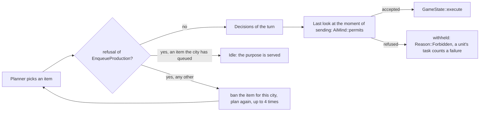

# The AI sends only orders the rules accept

**The core refuses none of the orders the game's AI sends: 0 of 580,268 commands in 20 full games (5 map scripts x 4 seeds, six nations, 300 rounds), against 22,050 refused of 602,656 (3.7 %) before. The check is the rules' own, `PlayerQueries::refusal`, the validation the interface greys its buttons with, never a copied formula; it sits where an order is chosen and again at the last moment before it is sent.** State of 2026-10-23, branch `publish/ai-fixes`. Labels: [measured] = measured by me in this session.

Contract item 7 of [ai.md](ai.md) asks the AI to explain a choice; this file is the other half of the sentence: a choice the rules refuse is not made. The owner's wording: "the AI must not be able to do this at all".

## What was wrong [measured, origin/main, 20 games x 300 rounds, 6 nations, `examples/ai_refusals.rs`]

| Refused by the core | Count | Where it came from |
|---|---:|---|
| `FoundCity`: "city-states found no cities" | 20,208 | the settlers a city-state starts with: decided again every round |
| `SetUpRangedAttack` / `Pillage`: "embarked" | 407 / 248 | the advisors' orders for units afloat |
| `CityStrike`, `RangedAttack`: "nothing to attack" | 321 / 43 | two cities striking the same unit: the first kills it |
| `MarchTo`: unreachable / closed borders / no moves | 142 / 127 / 97 | a route the rules do not find (`validate` of a march does not look for one) |
| `ProposeDeal`: borders already open | 130 | two advisors asking for the same treaty |
| `EnqueueProduction`: "not a coastal city" | 80 | a work boat in a city the planner called coastal |
| `EnqueueProduction`: a world wonder already built | 39 | a wonder finished by another nation or queued by another city of the same turn |
| `RespondDeal`: "the deal is no longer possible" | 31 | `validate` did not ask what the deal asked when it ran |
| 15 other kinds | about 200 | |

The case the owner knew, a national wonder that needs a building in every city (the national college and the library), did **not** occur on origin/main: `ai_science::the_cities_order_only_what_the_rules_accept` passes there (run with `--ignored`, 3.4 s: the standard AI 0 refused, the control `direct` refused), `building_available` already asks `PlayerView::own_building_site`, which is the rule. The `#[ignore]` marker of 2026-10-22 was stale; the test runs again. The new scenario test `a_national_wonder_that_needs_a_building_in_every_city_is_ordered_only_when_every_city_has_it` (`tests/ai_legal_orders.rs`) pins it for `standard` and `strikes`: two cities, a library in one only, the AI orders no college; with a library in both it may, and every order it plans is accepted. The queue that jams is the one the rules let a head into and then refuse again: see "A queued head" below.

## The design

- `ai/legal.rs`. `refusal` is a new `PlayerQueries` method (`accepts` is `refusal(..).is_none()`); for `MarchTo` it also looks for the route the order will walk (`validate` of a march is cheap on purpose and finds none). The core's own `validate` of `RespondDeal` now asks `offer_problem` when the answer is yes, so a screen and the AI see that accepting is refused.
- **Production** (`planner_cities::plan_cities_with`): every city plans its orders; the rules are asked about the `EnqueueProduction` orders; a refused item is banned for the city (`Empire::refused`, read by `unit_available_in`, `building_available` and the space order) and the city plans again, at most `MAX_REPLANS` = 4 times. The empire's totals are those from before the failed plan. The orders of a list are a sequence: after a `ClearProduction` the queue the next order meets is not the one the rules see yet, so "queued already" is no refusal there, and a purchase after an order is not asked (the last look asks it).
- **Purchases and tiles** (`allocator::spend_gold`, `planner_cities::spend_gold`): asked before the gold is counted as spent.
- **Research**: `TurnBrief::researchable` is the set of technologies for which `ChooseTechnology` is accepted; the research planner chooses among them (its own prerequisite test is the fallback of the variants that do not ask).
- **Units and advisors**: `ClassicMind::decide_unit` replaces a refused order by `Reason::Forbidden` and counts a failed attempt on the unit's task (as a refusal at the core did); the advisors' proposals are checked at the last look, because a batch is a chain (a treaty, then the next).
- **The last look**: `AiMind::permits(game, rules, player, command)`, asked by the kernel driver when the command is about to be sent, against the game as it is then. `ClassicMind` answers with `ClassicGame::accepts_order`. A refused command is not sent, is traced as `Forbidden` and counted in `AiCounters::orders_stale`; the seat wrapper `Seated` forwards it to the seat's own mind.
- Counters (`AiCounters`): `orders_retried` (a city planned again), `orders_withheld` (refused and nothing took its place), `orders_redundant` (already queued, or a queued head put back that the rules no longer allow), `orders_stale` (allowed when planned, refused when sent).
- Variants: `Variant::checks_orders()` is true for `standard` and everything built on it but `unchecked`, the control (the AI before this work). The older variants (`direct`, `allocator`, ...) keep their orders unchecked.

## A queued head the rules no longer allow

`air_orders`, `war_orders`, `defend_now` and the other war paths clear a city's queue, put their order first and put the old head back. A head that was legal when it was queued can be refused now (a settler of a city that shrank, "empire very unhappy", a caravan with no route left): the core checks that at the moment of the order only, so such a head sits in a queue untouched until a clear-and-put-back meets it, and then it is dropped. Counted as `orders_redundant`; 4 in 10 games of 200 rounds [measured].

## Measurement [measured]

`cargo run --release -p aurelia-qa --example ai_refusals -- standard small 4 300 100` (5 scripts x 4 seeds, 6 nations, 300 rounds, 580,268 commands applied):

| | refused by the core | withheld at planning | stale at the last look |
|---|---:|---:|---:|
| origin/main (`unchecked`) | 22,050 (3.66 %) | - | - |
| `standard` now | **0** | 20,581 | CityStrike 318, MarchTo 230, Pillage 264, SetUpRangedAttack 238, ProposeDeal 175, RangedAttack 56, RespondDeal 31, SpreadReligion 27, EnqueueProduction 40, HurryProduction 20, others 7 |

The withheld ones are almost all the city-states' settlers (`FoundCity`: the rules forbid a city-state to found, the AI asks again every round; the order costs a `validate` and no turn). The stale ones are orders that the first order of the same batch made useless: a second city striking a unit the first killed, a second march onto a tile the first took; production and purchases stale in fewer than one in a thousand: two cities of one turn ordering the same world wonder, and a defender bought in the turn it is ordered (the price of an item that is not yet the head of the queue cannot be asked of the core; `affordable_now` still uses the hurry formula for the first estimate).

Test: `aurelia-qa/tests/ai_legal_orders.rs`, 5 map scripts x 2 seeds, 200 rounds, 6 nations: the core refuses 0 commands of the standard AI; no city's order is withheld without another taking its place; no research, tile or faith purchase goes stale; production orders go stale in less than 1 in 1,000; the control `unchecked` is refused (production orders among them), otherwise the test proves nothing.

Strength (bench `pace`, 100 maps x 2 seatings, 500 rounds, `--candidate standard --baseline unchecked`): offset 0: 49.5 % (95 % CI 48.5-50.0), paired score difference -1.0 (-2.2...-0.0); offset 20: 50.0 % (50.0-50.0), -0.4 (-2.1...+1.4); rejected 0.00 % against 0.37 %; the AI turn takes the same time (p50 1.83 / 1.78 ms). A first version that asked the rules about every decision of a batch at planning time (advisor chains, a clear and a put-back) cost -18.9 (-45.7...+6.4) and -12.9 (-33.6...+9.9): a chain is not a list of independent orders, hence the last look.

## Not done

- The orders that a batch makes stale are not re-planned; they are withheld and the next turn plans again.
- `PlayerView::accepts` stays an oracle for what stands on a tile the player has not seen (a paradrop onto an occupied tile is refused, a nuke whose blast would reach a player not at war is refused): the same residual as in [ai-truth-reads.md](ai-truth-reads.md) section 3, item 4; the twin tests found no divergence.
- The barbarians' orders (`ai::barbarians`) and the city-states' go through the last look but not through a planner check.
