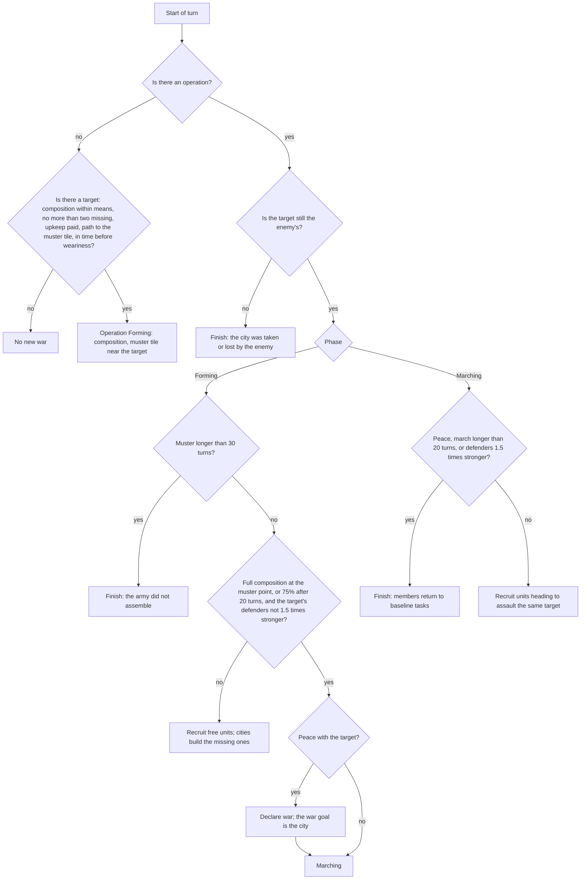

# AI operations: an army as a group

> Variant names in the entries are as of the day of writing; `standard` between promotions is the current `allocator`, `baseline` is `legacy`. The correspondence table, the current `standard` and the status of the goals are in [ai.md](ai.md), sections 3–4. State of the document: October 16–19, 2026.

Step 3 of the section "M6.2. A coherent AI" ([ai.md](ai.md)) and the military part of step 4. The AI variant `operations`
(`classic_rules::ai::variant`, code in `ai/operations.rs`) is built on `tactics` (classic/docs/ai-tactics.md): the fight at the target
is led by the same front (`ai/front.rs`), but the army is brought to the target by an operation, production completes whatever it
lacks, and war is declared only when the operation can take the city in time. Verification is the tournament bench
(platform/docs/ai-bench.md) and the scenarios in `tests/ai_acceptance.rs`.

**Result:** the win share on the bench is above noise against both earlier variants, on the main and the held-out set:
against `baseline` 55.5% (53.2–57.8%) and 57.0% (54.0–60.0%), against `tactics` 56.5% (54.0–59.0%) and 56.0%
(54.0–58.0%); on the new set (offsets 60–64) 57.2% (54.5–60.2%) and 55.0% (52.8–57.2%); the paired
score difference is +23…+34 points per seat (95% CI of the bootstrap over seed blocks, platform/docs/ai-bench.md, "Statistics"; the earlier
Wilson intervals were about twice as wide). But the gain comes almost entirely not from conquest but from the AI no longer fighting wars it cannot
win: a variant that never declares war and leaves other people's wars after 15 rounds wins no less on the same seeds
(56.7%), while operations with an army built for the war win less (50.8%). All games
still end with a victory by time at round 300; until round 100 the decisions do not differ from `baseline`.
The limit is the AI's economy (see "What limits it"), and that is the work of step 4.

## Why

With `tactics` the fight at a city is strong, but wars rarely end in a capture: reinforcements go to the target one at a time
(each unit's `Assault` task), groups at the city have up to four fighters, a siege is ready in ~10% of checks, the city
heals 20 HP per turn. Production does not know about the war: the army is the "strongest available unit" up to a limit, and there are no siege units
or ranged units for a specific city. War is declared when the sum of strengths is greater than required, not when the army
is assembled and can reach the target before war weariness sets in.

## Model

An operation is a record in the player's AI memory (`kernel::ai::state::Operation`, saved together with unit tasks):

| Field | What |
|---|---|
| `target` | the tile of the enemy city — the key: one operation per city |
| `enemy` | the owner of the city when the operation began |
| `muster` | the muster point: a tile near the target outside the city's strike range (`STAGING_DISTANCE` = 3), reachable by a path |
| `need` | the required composition `Composition { melee, ranged, siege }` by the estimate of the target's defense |
| `phase` | `Forming` (muster and production) or `Marching` (march and combat) |
| `since_round`, `phase_round` | when the operation began and its phase |

Invariants:

- **One owner.** An operation is created, moved through phases and finished by one function at the start of the player's turn
  (`operations::plan`, from `ClassicMind::start_turn` (`ai/driver.rs`), where the player's map for pathfinding is available); unit decisions only
  read it.
- **A unit is in at most one operation.** Membership is the unit task `UnitTask::Operation { target }`; a unit has
  one task, so it cannot be in a second operation. There is no separate list of members (a single source of truth).
- **No task without an operation.** Finishing an operation (`AiState::end_operation`) clears the tasks of all its members;
  an `Operation` task is invalid if the operation does not exist.
- **Observation only.** The target is assessed from the memory of seen cities (population), the threat (the strength of enemy units near
  our cities and near the target — what the player sees) and the rules' combat formulas (shown by the interface); the path is over the
  player's known map. Hidden information is not read.
- **The route** is not stored: the path to the muster point is checked when the target is chosen, after that each member finds its path itself
  (deterministically); the cohesion of the march is by the median of the members' distances to the target.

A war that no operation is conducting ends in peace as soon as the minimum war duration has passed
(`MIN_WAR_ROUNDS`, 15 rounds): this is how the war after a finished operation ends, and a war declared on us if
there is no counter-operation (peace in these rules is one-sided). From step 6, `leaders` ends a war with a nation
only through a peace deal by value (classic/docs/ai-leaders.md, "Peace by value").

## Composition by the target's defense

`operations::composition` is a planning model, not a simulation. A city is assessed from observation:

- **strength** (hundredths, as in the combat rules): 8 + 0.4 × population (from the memory of the city) + a technology part
  (by our share of discovered technologies — era parity) + garrison (our best melee fighter / 5);
- **HP** — 200 (walls are not visible), **healing** — 20 HP per round.

Strikes are the expected damage of the rules' formulas (`combat::damage`): the best melee fighter available by technology against the
city and the damage in return to it, the best ranged unit or siege weapon with the bonus against cities from its free
promotions (+200% for siege units). The composition grows from "2 melee + 1 ranged" until the front's siege model
(`front::siege_rounds`: ranged units hit down to 1 HP, melee hits while the fighter still has 25 HP, the city heals) takes
the city in 3 rounds (a round faster than the front requires). The next unit is ranged (siege, if there is
one) when a melee fighter loses 34 HP or more per strike or there are fewer ranged units than fighters; otherwise melee.
Cover: one melee fighter per unit of strength in the enemy army seen near our cities or the target
(at most three). More than 12 units means the target is too strong.

## The war decision

An operation begins (in peace once every 5 rounds, during war every turn) only if:

- **target**: a city of a met nation within 14 tiles of our cities; in peace — from round 30, with two of our
  cities, peace with it for longer than 30 rounds and no other wars; during war — the cities of the one we are at war with;
- **the army almost exists**: the missing units number no more than `MAX_WAR_ORDERS` = 2 (the rest are free units: without
  a task, on assault, or extra in a garrison beyond what the city needs) — see "Measurements": an army built for a war
  costs more than its captures bring;
- **upkeep**: the treasury pays the gold deficit from the missing units for 40 rounds (`war_chest_covers`);
- **path**: from our city nearest to the target over the known map to a tile 3 tiles from the target (in peace
  closed borders stop the path at them — that is the muster point; beyond that no more than 5 tiles of enemy land,
  otherwise the target is unreachable: another continent);
- **horizon**: the muster (building the missing units with half the empire's production + 5 turns + the path to the muster point) takes no
  longer than 30 turns; in peace the strike (path from the muster point × 2/3 + 1) and 8 turns of siege fit within half the weariness limit
  (30 rounds; the war begins at departure); during war everything together fits within the rest of the limit (60 rounds);
- among the suitable — the one with the smallest "muster + strike", on a tie the nearer one; paths are checked for no more than three.

## Production for an operation

While an operation is assembling (`Forming`), the missing units by role (`need` − members − units of those roles in queues)
are ordered from cities — this is one more need in `planner_cities` (right after the urgent defender):

- **which cities**: by descending production, no more than half (rounded up); a unit is built for no longer than
  10 turns; there is no military unit in the queue; the head of the queue is not a settler, not a worker, not a wonder and not a project;
- **limits**: the army limit is the whole difficulty supply (the share of the `Attack` strategy); a gold deficit from new units is
  acceptable only while the treasury pays it for 40 rounds (otherwise the treasury goes negative and the units are disbanded);
- **order**: the queue is cleared, the operation's unit goes first, followed by the former head (the city's accumulated production
  transfers to the unit);
- **role**: siege first, then ranged, then melee; if there is no siege unit by technology, a ranged unit takes its place;
- orders stop when the composition is assembled, the operation has set out, or it is finished.

`baseline` and `tactics` do not create operations, so their production does not change.

## Execution

- **Recruiting** (every turn): in `Forming` — free military units within 15 tiles of the muster point, nearest first,
  while the role is needed, then up to two more beyond the composition; in `Marching` — units that received an assault task on the same target
  (reinforcements merge into the operation instead of going one at a time).
- **Muster**: a member goes to the muster point and stands 2 tiles from it outside the city's strike range; healthy
  members within 3 tiles count as assembled.
- **March**: a member goes to the target; one who gets ahead of the median of the members' distances to the target by more than 2 tiles waits.
  Enemy units or a city in sight — the front decides.
- **Combat** at the target is the `tactics` front: members of a marching operation are its participants, the operation's city is the siege target;
  muster on the ring outside the city's strike range, strike when the siege is ready. A wounded member heals on the ring with the army and stays
  in the operation (with `tactics` a wounded unit goes home).

## Across water and the fleet

- **Boarding a boat** is part of the move: a land unit with embarkation (unlocked by a technology)
  goes to the target over water as over land; a target on another island is reachable if there is a path across the sea. Siege units
  and ranged units on board do not fire, so on the shore they become land participants of the front again.
- **Islands.** A settler looks for a site on any island reachable over water — on "Archipelago" the nations
  found cities on neighboring islands without a special rule (`naval_ai.rs`).
- **Fleet** (`ai/fleet.rs`): if an operation's target is a coastal city, it needs two warships. A coastal
  city orders the strongest available one (a firing ship: Galleass, then Frigate and onward) by the same rule
  as for the army (no longer than 10 turns, otherwise a purchase; the share of cities committed to war is shared with the army). The ship goes to a
  tile within firing range of the city, shells it together with the army and heals in port. Without a target at sea the
  ship stays in port; the former role "Naval = Idle" is gone.
- **An honest caveat.** The standard AI is peaceful by design: the value of war is almost always negative, so
  naval invasions in ordinary games are rare (about 3 of 50 "Tiny Archipelago" games reach war,
  and there were no captures in them). The end-to-end path "fleet plus landing → city taken" is proven by the scenario tests
  `operations_conquest_across_a_strait` and `a_naval_invasion_builds_a_fleet_and_shells_the_coast`.

## Saving

Operations are part of the AI memory (`persistence::ai`, version 2: after the player records — each player's operations;
the `Operation` task is code 7). Memory without operations is written in the version 1 format, byte for byte as before:
the frozen save in `aurelia-qa/tests/fixtures` and the pinned hashes do not change. Version 1 saves
load with an empty list of operations. Tests: a round trip of memory with an operation and an `Operation` task, reading
version 1 and 2 bytes, corrupted codes; a game of four `operations` AIs, saved to bytes at round 110 with
an army on the march, plays 10 rounds after loading with the same hashes and the same memory as without the save
(`an_operation_survives_save_and_load`).

## Measurements

October 16, Apple M4 Max, `--jobs 12` (the machine was shared with other agents: timings are a rough guide). The `standard` bench
(80 games of 300 rounds per run), `--repeat 5`: the main set is offsets 0–4, the held-out set is 10–14 (not tuned
on).

| Run | `operations` win share (95% CI) | By runs | Score r100 / r200 / end: `operations` vs the opponent |
|---|---|---|---|
| vs `baseline`, main | 222 of 400 = **55.5%** (53.2–57.8) | 57.5 / 55.0 / 60.0 / 52.5 / 52.5 | 194.6 / 430.7 / 646.9 vs 194.6 / 421.9 / 619.2 |
| vs `baseline`, held-out | 228 of 400 = **57.0%** (54.0–60.0) | 53.8 / 55.0 / 56.2 / 61.3 / 58.8 | 196.7 / 436.1 / 651.3 vs 196.3 / 425.5 / 623.0 |
| vs `tactics`, main | 226 of 400 = **56.5%** (54.0–59.0) | 61.3 / 60.0 / 51.2 / 53.8 / 56.2 | 195.5 / 431.7 / 649.1 vs 195.4 / 422.5 / 622.9 |
| vs `tactics`, held-out | 224 of 400 = **56.0%** (54.0–58.0) | 52.5 / 55.0 / 53.8 / 61.3 / 57.5 | 196.8 / 435.9 / 650.2 vs 196.7 / 427.9 / 626.7 |
| vs `baseline`, new (offsets 60–64) | **57.2%** (54.5–60.2) | | paired score difference +34 (+27…+41) |
| vs `tactics`, new (offsets 60–64) | **55.0%** (52.8–57.2) | | paired score difference +27 (+22…+32) |

The interval is the 95% CI of the bootstrap over seed blocks (platform/docs/ai-bench.md, "Statistics"; recomputed on October 16, same games). "What was tried" below is the earlier calculation (Wilson by game, wider than the real one); those versions were not recomputed.

All victories are by time (not one victory by conquest, science, culture or diplomacy before round 300);
nobody was eliminated, except two `tactics` seats in the run against it.

Combat (sum over a side's seats across 400 games; "wars" are war-declaration entries in the side's log):

| Run | Side | Cities taken | Lost | Units killed | Units lost | Wars |
|---|---|---:|---:|---:|---:|---:|
| vs `baseline`, main | operations | 53 | 30 | 37,591 | 14,539 | 801 |
| | baseline | 11 | 27 | 42,072 | 21,536 | 2,050 |
| vs `baseline`, held-out | operations | 44 | 23 | 37,423 | 14,420 | 755 |
| | baseline | 24 | 36 | 43,216 | 21,723 | 2,036 |
| vs `tactics`, main | operations | 56 | 46 | 36,998 | 14,578 | 812 |
| | tactics | 61 | 62 | 39,808 | 17,936 | 2,084 |
| vs `tactics`, held-out | operations | 45 | 47 | 35,815 | 14,042 | 785 |
| | tactics | 82 | 64 | 39,817 | 18,172 | 2,067 |

The life of operations (`operations` vs `baseline`, offset 0, 80 games, 200 candidate seats): 111
operations started, 73 set out, 6 achieved their goal; 27 did not assemble within 30 turns. The first operation came no earlier than
round 133, the median start was round 223.

Time. Bench, all seats of one variant (`--solo`, 40 games, two runs): round p95 15.5 ms for `baseline` and
14.6–14.8 ms for `operations` (−5%), medians 4.7–4.8 ms for both; the `--solo baseline` hash is `95f26b3595363dc3`, as in
`integration/benches/ai/baseline.json`. `ai_rounds 3 8 2 representative`, three alternations: `baseline` median 9.7–9.8 ms,
p95 10.2–10.4; `AI_VARIANT=operations` 9.7–9.8 and 10.3; `stress`: 131.0 / 140.6 vs 132.5 / 143.7 ms
(+1–2%, within noise). The pathfinding to the muster tile is done no more than once per 5 rounds in peace, for no more than three targets.

### What was tried (main set, offsets 0–2, 240 games, unless stated otherwise)

| Version | Change | Win share | Cities taken |
|---|---|---|---|
| v1 | the muster point is our city, war at departure, cancellation on losing two thirds; 400 games | 51.2% (46.4–56.1) | 113 |
| v4 | the path to the target is checked, the muster tile at the target's border, peace in a war without an operation; 400 games | 51.8% (46.9–56.6) | 81 |
| v6 | army upkeep from the treasury (40 rounds), the siege bonus against cities in the estimate | 52.7% (46.4–58.9) | 65 |
| v7 | march no longer than 20 rounds | 52.3% (46.0–58.5) | 62 |
| v8 | the wounded heal with the army, cancellation if defenders are 1.5 times stronger | 50.8% (44.5–57.1) | 60 |
| **v8, no more than two missing** | **the adopted variant** | **57.5% (51.2–63.6)** | **31** |
| control: never declare war | operations do not begin, peace after 15 rounds of any war | 56.7% (50.3–62.8) | 1 |

## What limits it

1. **The AI's economy, not combat.** For `baseline` on average (20 games, 80 seats): an army of 1.6 / 2.5 / 3.9 / 6.7 / 9.4 /
   12.5 units at round 60/100/150/200/250/299 with 1.9 / 3.3 / 3.9 / 4.4 / 5.1 / 5.5 cities; gold income
   +3.5 / +1.8 / +10.4 / +13.1 / +14.7 / +13.1 per turn; about 300–360 in the treasury. An empire cannot
   support an army of 5–8 units for a city: of 1,713 target checks (16 games) 1,223 were rejected on upkeep (the deficit is not paid by the
   treasury for 40 rounds), 358 on the horizon (muster longer than 30 turns), 9 on target strength. So wars begin after
   round 130, and until round 100 the decisions of `operations` coincide with `baseline` (the score at r100 is equal for both sides).
2. **An army built for war does not pay off in score.** Without the build limit (v8) operations take twice as many
   cities (60 vs 31), but the win share drops to 50.8%: producing and maintaining the army takes away growth,
   technologies and buildings, and a late-game captured city (population 4–10) brings less. The Civ V score for a city is
   8 + 4 × population + land tiles (× a small-map correction), for a technology 4; with 4–6 nations a victory by
   time goes to the best score, and a capture from one opponent does not reduce the others' score.
3. **Peace is one-sided.** The victim leaves the war itself: `baseline` makes peace after 15 rounds if there is no army of ours near
   its cities, and after 30 if it is losing. Of 155 operations that set out (v7), 36 ended in
   peace, 25 of them exactly on the 16th round of the war. So a city has to be taken within 15–30 rounds of the declaration: the army
   sets out from the border (the muster tile), but late cities (strength 18–27, 4–6 defenders around) are rarely
   taken in that time: 50 of 155 operations were cancelled because the defenders were stronger than the army, 16 on the march limit,
   and 15 reached their goal.
4. **There are no other victories.** In 300 rounds no game ended by science, culture, diplomacy or
   conquest: no AI variant leads to them deliberately.

## What to do in step 4

- **The price of war in the common measure of value.** An operation is a goal with a value (the score gain from the city, damage to the score
  leader) and a cost (the army's production, upkeep over the length of the war, expected losses, lost growth); the allocator
  chooses it only when "value / cost" is higher than for buildings, settlers and wonders. For now this is crudely
  replaced by the rule "no more than two missing units".
- **A war chest as an allocator goal:** save gold (without purchases and gifts to city-states) for a
  planned operation instead of hoping for what is left in the treasury.
- **Economy before war.** An income of +2 gold and 2.5 units at round 100 is the main limit: step 4 must
  raise income and production (workers, trade routes, gold buildings), otherwise any military strategy
  runs into upkeep.
- **An early war is cheaper than a late one:** cities at rounds 40–100 are weak (strength 10–12, a single garrison), but without a treasury
  and an army it cannot be started; the allocator must see the value of an early operation (the city grows for 200 rounds).
- **Peace by value, not by timer** (step 6): the victim's one-sided truce after 15 rounds makes late-game
  sieges almost impossible; diplomacy through goals must resolve this too.
