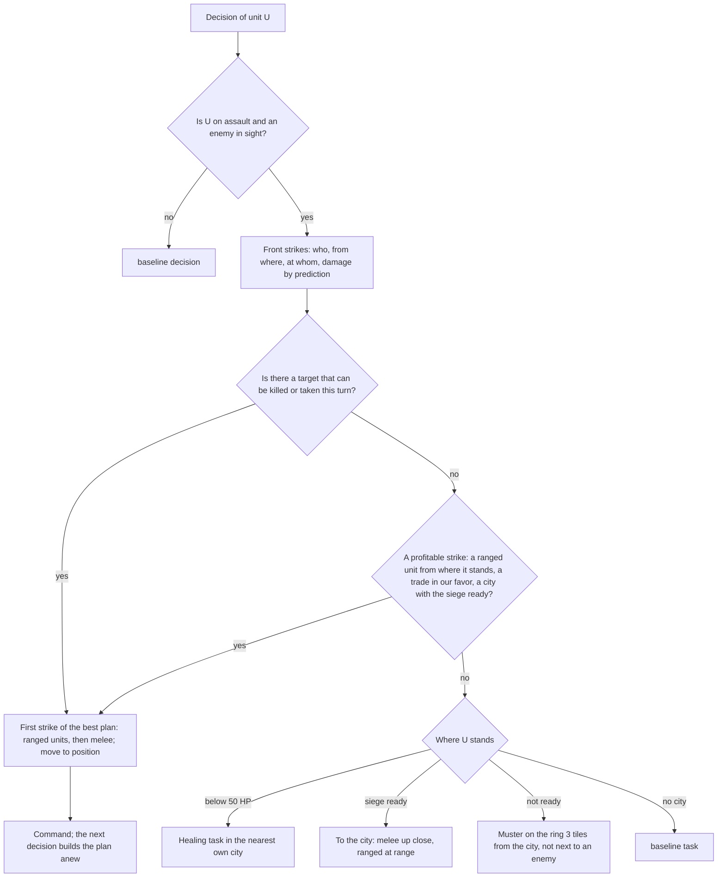

# AI tactics: the front and strike combinations

> Variant names in the entries are as of the day of writing; `standard` between promotions is the current `allocator`, `baseline` is `legacy`. The correspondence table, the current `standard` and the status of the goals are in [ai.md](ai.md), sections 3–4. State of the document: October 16–19, 2026.

Step 2 of the section "M6.2. A coherent AI" ([ai.md](ai.md)). The AI variant `tactics` (`classic_rules::ai::variant`, code in `ai/front.rs`) replaces the tactical decisions of `baseline`: what an assault unit does near an enemy. Strategy, production, unit tasks, garrisons and the march to the war target are the same as in `baseline`. Verification is the tournament bench (platform/docs/ai-bench.md) and the "conquest" scenarios (`classic/crates/classic-rules/tests/ai_acceptance.rs`).

**Result:** combat is noticeably stronger — 4–7 times more cities taken, 14–16% fewer of its own units lost, "conquest" passes on all 60 seeds checked (with `baseline` at 12 tiles, on 2 of 20). The win share on the bench rose only a little: 49.6% (47.4–51.9%) on the main set, 52.1% (49.9–54.2%) on the held-out set and 52.9% (50.7–55.0%) on the new one (offsets 60–64), 51.5% (50.2–52.9%) together; the paired score difference is +7…+10 points per seat (95% CI of the bootstrap over seed blocks, platform/docs/ai-bench.md, "Statistics"; the earlier Wilson interval of 44.8–54.5% was twice as wide and hid this gain). A victory by time is decided by the economy, and wars rarely end in a capture: the armies are too small for a siege. That is the work of steps 3 (operations) and 4 (allocator).

## What was wrong

`baseline` decides for each unit separately: it attacks a neighbor with a force advantage of 1.1 : 1, waits for a group of three units two tiles from a city for no longer than 8 turns, and retreats home below 35 HP. The strikes are not coordinated: ranged units, melee and finishing blows go in the order of unit numbers; siege arrives one or two units at a time, the city hits them one by one and heals 20 HP per turn. On the standard set over 300 turns, 200 seats declared 311 wars and took 6 cities.

## Model

- **The front** is rebuilt at every decision of unit U from its local observation (radius 5, the same as `baseline`): enemies are units and cities at war with us that the player sees now; participants are our military units with an assault task (`UnitTask::Assault`), at most 12, those nearest to U first. Garrisons, scouts, escorts and the wounded who are healing stay with `baseline`. If there are no enemies or U is not on assault, `baseline` decides.
- **A strike** is a triple "unit, tile, target" and its prediction by the core formula: `PlayerQueries::attack_preview_from` (a new public query: a preview of a move and an attack, which the Civ V interface shows when hovering over an enemy across a tile; a siege weapon is counted as deployed; from its own tile it equals `attack_preview`). Reachable tiles and the remaining movement are `PlayerView::own_reachable` (a new core query: a movement preview by the rules of the order — borders, visible enemies, zones of control). The strike tile is one with movement left, the least dangerous (city strike, adjacent enemy fighters), and a ranged unit keeps its distance. The AI does not read hidden information.
- **Focus.** For each target, strikes one per unit: first ranged units in descending order of damage, then melee in descending order of "dealt − received"; against a city the ranged units do not lower it below 1 HP, and the last strike is melee (capture). A target is *taken* if the expected total damage is not less than its HP. Of such targets the best by "value − cost" is chosen: the value of a city is 1000 + 20 per citizen, of a fighter 60 + 4 × strength, of a civilian 40; the cost is the expected damage to our units and 100 for a strike after which the attacker may die. A tie is broken by the target's tile.
- **Order.** The decision returns the first step of the best plan — it may belong not to U but to another participant: the driver executes the command on behalf of its unit, and U stays in the queue. The command is checked by `accepts` before returning; a rejected step is thrown out and the next is taken (up to 4 times), so the decision does not loop. After each command the plan is rebuilt: an unlucky roll changes the plan, a killed target disappears.
- **Without a kill** — profitable strikes: a ranged unit always shoots a unit, and a city from where it stands or when the siege is ready; melee against a unit if the damage dealt is not less than one and a half times the damage received and the attacker keeps 50 HP; against a city, when the siege is ready, if 25 HP remain.
- **The siege is ready** if the group (healthy participants within 4 tiles of the city, each with a strike this turn or a predicted strike from a tile adjacent to the city) takes the city in 4 rounds in the model: each round the ranged units strike (the city not below 1 HP), then each melee fighter while it has 25 HP left; the city heals 20 HP per round; it falls to a melee strike. One check for both the approach and the strike: whoever is within reach strikes, the others approach.
- **Muster.** While the siege is not ready, participants wait on the ring 3 tiles from the city — outside its strike (range 2), not next to enemy fighters; the tile is the one with the least danger, closer to the ring, with more movement remaining.
- **The wounded.** A participant below 50 HP gets a healing task in the nearest own city (a `baseline` task: goes home and stands until full health) and leaves the front; healthy, it returns to the assault through `baseline` tasks. A wounded unit does not stand idle by the wall.
- **Budget.** Per decision, no more than 120 predictions; the movement preview is computed only when the target is out of reach from where the unit stands, and only for targets no farther than the unit can reach by road. Everything is deterministic: participants by distance and id, targets by distance and tile, ties by id and tile.

## What was tried (bench: standard, `--repeat 5`, offsets 0–4, 400 games)

The intervals are the earlier calculation (Wilson by game, wider than the real one: the effect of the `tactics` plan against `baseline` ≈ 0.2); versions v1–e4 were not recomputed, their code is gone. The final v6 by seed blocks is 49.6% (47.4–51.9%).

| Version | Change | Win share (95% CI) | Cities taken: tactics / baseline | Units lost: tactics / baseline |
|---|---|---|---|---|
| v1 | siege when the group takes the city in 2 rounds (total damage); 1 run, offset 0 | 48.8% (38.1–59.5) | 29 / 11 | 3,910 / 4,921 |
| v3 | two checks: "approach" by the group, "strike" by those standing within reach; 1 run, offset 0 | 53.8% (42.9–64.3) | 11 / 6 | 3,806 / 4,996 |
| v4 | one check, a 4-round siege model with remaining HP | 47.8% (42.9–52.6) | 101 / 29 | 19,964 / 24,630 |
| v5 | one radius-5 observation per decision (turn time) | 49.4% (44.5–54.3) | 106 / 27 | 19,898 / 24,310 |
| e1 | v5, siege in 6 rounds, a strike leaves 15 HP | 49.6% (44.8–54.5) | 130 / 25 | 20,311 / 24,358 |
| e2 | v5, siege in 8 rounds, 10 HP, group within 5 tiles | 49.1% (44.3–54.0) | 123 / 26 | 20,592 / 24,541 |
| e3 | v5, melee when "dealt ≥ received" | 49.5% (44.6–54.4) | 95 / 26 | 20,160 / 24,381 |
| e4 | v5, heal below 40 HP, return at 70 | 46.4% (41.5–51.3) | 107 / 26 | 19,498 / 24,293 |
| **v6** | **participants are only units on assault, the wounded heal at home** | **49.6% (44.8–54.5); by seed blocks 47.4–51.9** | **83 / 21** | **20,793 / 24,796** |

v1–v5 kept the wounded in the front (a healing task also made a unit a participant): the wounded fought barbarians and healed in the field instead of escorting settlers and garrisons. With v4 the `tactics` score was below `baseline`'s by 0.3–3 points by turn 100 and by 4–11 by turn 200 in all five runs. v6 removed this: the score at turns 100 and 200 evened out, at the end the average is +7 points (−1…+16 across runs), within noise.

## Measurements of v6

| Run | `tactics` win share | Cities taken / lost | Units killed / lost | Wars declared |
|---|---|---|---|---|
| standard, offsets 0–4 (main) | 198.5 of 400 = **49.6%** (47.4–51.9%), by run 53.8 / 48.8 / 48.8 / 49.4 / 47.5% | tactics 83 / 45, baseline 21 / 50 | tactics 44,221 / 20,793, baseline 45,389 / 24,796 | 1,443 / 1,407 |
| standard, offsets 10–14 (held-out, not tuned on) | 208.5 of 400 = **52.1%** (49.9–54.2%), by run 48.8–56.2% | tactics 109 / 51, baseline 15 / 56 | tactics 44,588 / 20,957, baseline 44,505 / 24,365 | 1,492 / 1,437 |
| standard, offsets 60–64 (new, October 16) | **52.9%** (50.7–55.0%); together with the first two 51.5% (50.2–52.9%) | | | |

The intervals are the 95% CI of the bootstrap over seed blocks (platform/docs/ai-bench.md, "Statistics"); the paired difference of the final score `tactics` minus `baseline`: +6.9 (−0.5…+14.0), +10.0 (+5.3…+14.7), +10.2 (+5.5…+14.9) points per seat.

"Conquest" (13 warriors against a city with one warrior; the target at 8, 10, 12 tiles; 20 seeds per distance): `tactics` takes the city without peace before the capture on all 60 seeds, on turns 49–53 (on average 49.6 / 51.6 / 51.5); `baseline` — at 8 and 10 tiles on all seeds, but later (turns 52–94, on average 63.1 and 55.7), at 12 tiles only on 2 of 20 (in the rest, peace through weariness). The test `tactics_conquest_at_every_distance` pins 3 seeds × 3 distances; the `baseline` test at 12 tiles stays `#[ignore]`.

Time (Apple M4 Max, release; the machine was shared with other agents). `ai_rounds 3 8 2 representative`: `main`, this branch and this branch with `AI_VARIANT=tactics` — median 9.7 ms, p95 10.2–10.3 ms (there are almost no fronts in this scenario). `stress` (5 runs, three alternations): `main` 123.7–129.0 ms, the branch 127.1–128.8 ms by median with the same work counters — noise and code layout; `tactics` 130.7 ms (3 runs). Bench, all seats of one variant (`--solo`, two runs): round p95 16.4–16.5 ms for `baseline` and 17.1–17.6 ms for `tactics` (+4–7%), player turn p95 2.58–2.64 vs 2.78–2.87 ms (+7–10%), medians equal. Head-to-head (offsets 0–4): the `tactics` turn by p95 is 3.0–3.4 ms against 2.6–2.9 ms for `baseline` in the same games (+15–20%).

## What next (step 3, operations)

The front lives for one decision: it has no memory of the army's composition, a muster point out of sight, a route, or the moment of departure. Reinforcements go to the target one at a time by `baseline` tasks and merge into the muster at the city. A measurement on v2 (80 games): the siege is ready in 9.5% of checks at a city: a fighter deals the city 15–30 HP and takes 30–40, a city with 200 HP heals 20 per turn, and half of the groups at a city have up to 4 fighters. For a victory in combat to become a victory in the game, operations are needed (the army assembles out of reach and sets out in a wave of the needed composition, the retreat decision belongs to the operation) and an allocator (production builds an army for the war and siege units).
