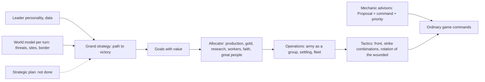

# AI: the goal chain, the contract, variants and goal status

**The game's AI is the `standard` variant: leaders with a personality choose a path to victory, a single allocator spends resources by score points, operations lead armies, tactics strike by combat prediction, and all of it sees the world only through observation. The main gaps: there is no strategic plan, units and the fleet are accounted for only at the tactics level, and some heuristics named policy branches and beliefs by name.** State as of October 19, 2026. Labels: [verified] — read in the code in this session, [report] — taken from measurement documents and not re-checked.

This file is the single source on the architecture, the contract and the goal status of the AI. The per-step measurement logs lie alongside (section "Document map"); they do not repeat what is written here.

## 1. The chain

| M6.2 step | What it does | Where the code is | Measurement log | Status |
|---|---|---|---|---|
| 1. Bench | AI versions play against each other; bootstrap over seed blocks | `aurelia-qa`, `bin/ai-tournament` | [ai-bench.md](../../platform/docs/ai-bench.md) | done |
| 2. Tactics (`tactics`) | front, strike combinations by combat prediction, zones of control | `ai/front.rs`, `ai/tactics.rs` | [ai-tactics.md](ai-tactics.md) | done |
| 3. Operations (`operations`) | an army for a city: muster point, composition, war only with an operation that can make it in time; fleet | `ai/operations.rs`, `ai/fleet.rs` | [ai-operations.md](ai-operations.md) | done |
| 4. Allocator (`allocator`, `econ2` prices) | one measure — final score points; gold to the best use, happiness by action | `ai/value.rs`, `ai/allocator.rs` | [ai-allocator.md](ai-allocator.md) | done |
| 5. Personalities and grand strategy (`leaders`) | 9 inclinations for 43 leaders as data; a path to victory with hysteresis | `ai/grand_strategy.rs`, `ai/taste.rs` | [ai-leaders.md](ai-leaders.md) | done, with a gap (contract item 3) |
| 6. Diplomacy through goals (peace by value) and defense (`defence`) | war is a comparison of an operation's value with other goals; holding cities | `ai/peace.rs`, `ai/defence.rs` | [ai-leaders.md](ai-leaders.md), [ai-defence.md](ai-defence.md) | done |
| 7. Strategic plan | analysis of the rule set, a plan on the first turn, revisions | — | — | in progress: measurement, then the design ([ru/PLAN.en.md](../../ru/PLAN.en.md)) |

Prohibitions (spec, [platform/project.md](../../platform/project.md) §28, [platform/structure.md](../../platform/structure.md) §22–23): no behavior tree, universal rule engine, ECS or ML; one sequential pipeline, deterministic counting, stable tie-breaks; no cloning the world for brute-force search. **Exception (owner, 22 October 2026):** learned variants are allowed as new variants for experiments ([ai-neural-architecture.md](../../docs/ai-neural-architecture.md)); the default `standard` stays scripted until a learned variant wins its gates, and cloning the world is allowed in offline tools (training, what-if rollouts), not in the shipped player. Whether the AI needs a separate thread is to be decided by profile.

## 2. The contract

| # | Requirement | Status |
|---|---|---|
| 1 | The AI sees the world only through `AIObservation` and changes it only with ordinary commands; the non-interference test: two hidden parts with one visible history give identical commands | met, with one direct read and two public channels (below). Tests: (a) `classic/crates/classic-rules/tests/knowledge.rs` — twins (a foreign unit, a foreign city, a deposit, the terrain of a map corner, hidden from player 0) for the observation and for the whole AI driver, 30 rounds; the twins are compared until the player scouts one of the hidden tiles; (b) `integration/crates/aurelia-qa/tests/non_interference.rs` — the same turn played twice from the AI memory saved in mid-game on a world and on its copy with a different deposit, a foreign city and a foreign unit on untouched tiles: observations, commands and memory are equal; the advisor path: policies and pantheon (a BNW game of four AIs, twins every 3 rounds), Great Writer, excavations (it is checked that `AdoptPolicy`, `FoundPantheon`, `CreateGreatWork`, `Excavate`, `ChooseArchaeology` were really present in the compared turns); (c) twins in full `aurelia-qa` games (`invariants::check_non_interference`, every 25–50 rounds, `tests/full_game.rs`). Not covered by twins are the advisor paths of religion (beliefs after the pantheon), economy/trade, combat, diplomacy, barbarians, city-states, congress and espionage: they are checked only in (a) and (c) through the shared driver. **One direct read of the world:** `ai/great_people.rs::building_in_city` asks the core `engineer_may_hurry` about its own city through `PlayerView::world()` (the owner is checked) [verified]. **Two public channels outside `AIObservation`:** `PlayerQueries::race()` and `original_capitals()` (`knowledge/public.rs`) give the score of the met and the holders of the original capitals of all living nations, including unknown ones (a tile only if scouted); this is the Civ V "victory screen", accepted as public ([ai-leaders.md](ai-leaders.md), "What the leader knows"); filtering by contact was not done |
| 2 | Determinism; slicing by time does not change the decision: budgets of 1 / 7 / 100 decisions give the same commands and hashes | met [report: the step-by-step driver `ai/driver.rs`] |
| 3 | **Grand strategy bypasses no path to victory.** A neutral leader (all inclinations 5) plays the "score" path and no other: `Outlook` gives it weight 0 for science, culture, diplomacy and domination ([ai-leaders.md](ai-leaders.md), "Paths to victory in a single measure") | **a known gap**: the plan is being redone by the science-victory agent (section 5) |
| 4 | **Generality across rule sets (decision of October 19).** AI heuristics are derived from the rule set's data, do not name technologies, beliefs, policies, units and nations in the logic, are planned in advance and are verified on two rule sets (bench: `smoke` / `standard` for Civ V, `sandbox` for the sandbox; L&L — `lal`) | **not met**: `ai/religion.rs:32–47` lists beliefs (pantheon, founder, followers, enhancers) by keys [verified, `grep 'core:'` over `ai/`]; policies are taken from the rule set's role lists (`rules::roles`), but the order of branches "Tradition, then Liberty" is recorded in the comments of `ai/policies.rs:8–13` as BNW behavior; the choice of pantheon and policy branches is being redone by the pantheon agent (aa4d73e0, branch `civ5/pantheon`) and the policies agent (a0859d5e); the rest will come from the discrepancy audit |
| 5 | **The AI accounts for units: characteristics, firing range, movement, abilities, nations' unique units and when they appear, counters.** Example: an early rush window (a strong unique unit against a weak neighbor); defense with a counter unit or walls. All generalized, from the rule set's data, without names | **not done** as a strategic requirement. It exists at the tactics and production level: a ranged unit does not go into melee (`ai/tactics.rs:46`), firing by range (`ai/combat.rs:108`), choosing the strongest available unit of a role and replacing it with a unique one (`ai/planner_cities.rs:608–625`), army composition by the target's defense ([ai-operations.md](ai-operations.md), "Composition by the target's defense"). Missing: accounting for abilities, the time a unique unit appears, the rush window, picking a counter unit. The project owner is the science-victory agent; the current war behavior is measured by the war audit **Update of 2026-10-23 (branch `publish/ai-fixes`):** every order the AI sends passes the rules' own check, so it never orders what the rules forbid ([ai-legal-orders.md](ai-legal-orders.md): 0 of 580,268 commands refused in 20 games, 3.7 % before); missiles and nuclear weapons (value model with the world's memory of a strike in it, basing, the project they need, the war case that counts them) and paratrooper jumps are part of `standard` ([ai-strikes.md](ai-strikes.md)), tested by scenes; the former `standard` is `previous`. They hardly occur in the bench games: the technologies are not reached and wars are rare |
| 6 | **The same for the sea:** ships, range, transport and landings, unique naval units, coastal defense, counters at sea and against land targets, maps where a rival is reachable only by sea | **partial.** Merged: a carrier carries two fighters, coastal shipyards, naval raiding, ships' retreat (953405c6, `tests/naval.rs`), the AI crosses water and keeps two warships for a coastal target (9cca6791, `ai/fleet.rs`, `FLEET_SIZE = 2`) [report]. Not done: naval landings are rare (about 3 games of 50 on "Tiny Archipelago" reach war), the AI does not build carriers and aircraft and does not base them (`ai/fleet.rs` orders only firing ships), there is no coastal defense or counters at sea, in L&L ships were not noticed in combat (A5: "ships 0%") [report: `~/civ/work/QUEUE.md`, classic-parity-2026-10-19] **Update of 2026-10-23:** carriers (built when a coastal target is out of the cities' reach, sailing with aircraft or weapons aboard, aircraft based on them) are in `standard`; the paratrooper jump is in `standard` ([ai-strikes.md](ai-strikes.md)); landing frequency is bounded by the war value (78 % of the candidate targets have a negative value on Tiny Archipelago), not by the crossing |
| 7 | Explainability: the `Reason` trace explains a choice and a refusal; no war/peace flip-flopping | met [report: `ai/trace.rs`, peace is two-sided — [ai-leaders.md](ai-leaders.md), "Peace by value"]. Flip-flopping is checked by `FlipWatch` in `tests/ai_acceptance.rs` (6 AIs, 300 rounds; plus six small-map seeds): after each round it reads the war state, so a war that ended with a deal (`RespondDeal`) counts as ended by `MakePeace`; a declaration after peace holds `PEACE_COOLDOWN_ROUNDS`, and `MakePeace` holds the strategy's `MIN_WAR_ROUNDS`. There is no lower bound on the age of a war for peace by deal in the code: peace by value (`ai/peace.rs`) is concluded without a timer, and the diplomacy advisor accepts peace after `diplomacy::ACCEPT_PEACE_AFTER_ROUNDS` = 5 rounds (the strategy has its own `planner_strategy::MIN_WAR_ROUNDS` = 15, the test `peace_is_accepted_before_the_strategy_asks_for_it` keeps the order). So the test does not assert the age of such a war but prints the shortest: 9 rounds in a game of six AIs, 2 rounds on small maps (seeds 1 and 4) [measured by me]. On main the test is green: 1 war (a game of six AIs) and 15 (six small seeds) ended with a deal, none by `MakePeace`; a declaration of war after peace no earlier than 50 rounds with a floor of 30 [measured by me] |
| 8 | Difficulty levels are data (bonuses and starting units), barbarians are a separate player | met [report: ru/PLAN.en.md up to October 19, M6] |

## 3. Variants and names

Every new AI version is a new variant next to `standard`; when it wins on the bench (or is no weaker and delivers what it was made for), it becomes `standard`, and the former stays as long as the bench needs it. The table was checked against `Variant::ALL` ([verified], `classic/crates/classic-rules/src/ai/variant.rs`: 23 variants).

| Variant | What it is |
|---|---|
| `standard` | the game's AI, with the heavy arms since 23 October (missiles, nuclear weapons, carriers, paratrooper jumps; `previous` is without them): `direct` with the science economy — a beaker by what technologies unlock, only permitted orders (classic/docs/ai-allocator.md "Science"). The third promotion, October 19; before it was called `reach` |
| `direct` | the former `standard`: `defence` with `allocator-econ2` prices — leaders, city defense, gold and happiness by usefulness (the second promotion, October 16); the control for the science economy |
| `sound` | `direct` whose cities order only what is permitted: separates the fix for rejections from the price of a beaker |
| `unchecked` | `standard` before the rules' own check of every order (23 October): the control of [ai-legal-orders.md](ai-legal-orders.md) |
| `previous` | `standard` before the heavy arms (23 October): without missiles, nuclear weapons, carriers, paratrooper jumps and the war case that counts them; the control of [ai-strikes.md](ai-strikes.md) |
| `strikes`, `landings` | `previous` with missiles and nuclear weapons only / with paratrooper jumps only (attribution) |
| `allocator` | `operations` with a single allocator in score points — the game's AI between promotions |
| `allocator-peace`, `allocator-econ2` | `allocator` without new wars (control) / with econ2 prices |
| `leaders`, `leaders-alone`, `leaders-econ2` | `allocator` with personalities and grand strategy / without peace by value (control) / with econ2 prices |
| `defence` | `leaders` that values holding its own cities — `standard` without econ2 prices |
| `legacy`, `tactics`, `operations` | the M6 planners (the game's AI before October 16) / with front combat / with operations |
| `nudged`, `one-city` | bench tools on `standard`: a noise threshold (40 candidates instead of 48) and a deliberately weak one (no cities after the capital) |

In measurement entries a name means what it meant on the day of the entry:

| In the entry | Now |
|---|---|
| `baseline` (before the first promotion) | `legacy` |
| `economy`, `economy-peace` | `allocator`, `allocator-peace` |
| `standard`, `standard-peace`, `standard-econ2` (between promotions) | `allocator`, `allocator-peace`, `allocator-econ2` |
| `defence-econ2` (before the second promotion) | `standard` |

The word "standard" means four different things; in this file and in [ai-bench.md](../../platform/docs/ai-bench.md) they are written like this:

| Word | What | Example |
|---|---|---|
| `standard` (code) | an AI variant | `--candidate standard` |
| the `standard` set | a bench set of games: 5 maps × tiny and small, 80 games, 300 rounds | `--suite standard` |
| the Standard speed | the Civ V game speed: victory by time at round 500 | [classic/rules.md](classic/rules.md), `STANDARD_MAX_ROUNDS = 500` |
| the Standard map size | the Civ V map size | `aurelia-qa`, [QA.md](QA.md) |

Rounds: the game ends with a victory by time at round **500** (`world/victory.rs:50`, `derived/maintenance.rs:40`, [verified]). The sets `smoke` (70), `standard` and `duel` (300) cut the game off earlier as a test horizon — "victory by time" there is the set's round; the `pace` set plays the full 500 ([verified], `aurelia-qa/src/bench/suite.rs`). AI prices depend on the length of the game (`Prices::rounds_left`), so the numbers of the 300-round sets and `pace` do not add up.

## 4. Goals and their status

A goal counts as reached by a measurement on the bench, not by a component test. [report] — a number from the measurement log, not re-measured.

| Goal | Threshold | Now | Label |
|---|---|---|---|
| AI round, representative map / stressed | ≤ 250 ms / ≤ 1 s | median 24–26 ms / 190–218 ms, p95 up to 46 / 246 ms, maximum 46 / 255 ms (`ai_rounds 3 8 2`, i9-10900K, load ≈ 10, three alternations with `legacy`, October 20). The earlier 10.5 / 130 ms were taken on an M4 Max. Under a load of 35–40 the wall time is two to three times higher (stress p95 up to 953 ms, at the threshold). Nothing checks the contract automatically | [verified by me, ai-bench.md "Re-measurement of October 20"] |
| Strength of `standard` | above noise | 500 rounds (`pace`, 20 blocks): against `allocator` 67.8% (63.0–72.0), against `direct` 64.5% (59.0–69.5), against `legacy` 94.0% (90.5–97.0). 300 rounds (`standard`, 8 blocks): against `legacy` 73.8% (68.1–80.0), against `allocator` **41.2% (33.1–48.8) — weaker**. The earlier "against `allocator` 58.8–61.8%" was the number of the former `standard`, `direct` (64.4% at 300 rounds now) | [verified by me, October 20, ai-bench.md "Re-measurement of October 20"] |
| Second city | ≤ round 38 | 37.4 (`pace` bench, October 19) | [report, ai-bench.md] |
| Four cities by round 100 | ≥ 4 | 3.5–3.6: not reached; six levers paid with strength | [verified on October 19 by classic-parity-2026-10-19, 40 games] |
| Seats at −10 happiness and below at the end | ≈ 20% | a 0.1 share of seats (Avoid Growth + libraries): reached | [report, ai-bench.md "Continuation"]; the 32% figure in QUEUE and QA is outdated |
| Conquest at 8, 10, 12 tiles; peace, seed 11 | green acceptance tests | green for `standard` (`tests/ai_acceptance.rs`); `conquest_*` pass on main b613023c | [report: ru/PLAN.en.md, re-checked by an agent on October 19] |
| Domination victory | reachable | almost unreachable: 1 in 1,600 `duel` games; the AI rarely sees foreign capitals | [report, ai-bench.md] |
| Science victory before round 300 | — | does not happen for the AI; the "≈ round 855" figure from QA.md predates the price and pace formulas; the science-victory agent measures `pace` ≥ 12 seeds | [report, QA.md item 1; in progress] |
| Entering eras (Standard) | Classical 60, Medieval 120, Renaissance 180 | 60 / 133 / 241 | [report, ai-bench.md "Game pace"] |
| AI aviation, carriers, missiles, nuclear weapons | — | aircraft since 21 October ([ai-air.md](ai-air.md)); carriers, missiles, nuclear weapons, jumps since 23 October, tested by scenes; in the bench games they occur in 3 of 100 games at most ([ai-strikes.md](ai-strikes.md)) | [ai-strikes.md](ai-strikes.md) |
| Orders the rules refuse | 0 | 0 of 580,268 commands (20 games); the control `unchecked` 3.7 % | [ai-legal-orders.md](ai-legal-orders.md) [measured by me] |

## 5. Open AI debts

| Debt | Size | Owner | Recommendation |
|---|---|---|---|
| Strategic plan (contract 3, 4, 5, 6 are resolved by it) | L | the science-victory agent, branch `civ5/science-victory` | first measure the science lag, then a design, then implement the smaller variant that pays off |
| War behavior with units and the fleet | M | war audit | give numbers before the plan design |
| Heuristics without names: beliefs, policy branches, pantheon, scouting | M | the pantheon agents (aa4d73e0, `civ5/pantheon`), policies (a0859d5e), scouting (a76507c7) | accept after the strategic plan; a generalized estimate, a test on a second rule set |
| Four cities by round 100 | L | not taken | a new mechanism is needed, not a seventh threshold tweak (classic-parity-2026-10-19, item 1) |
| econ2 happiness drops to −9 by round 300 | S | not taken | a property of the price; revisit together with the plan |
| The L&L AI hardly builds rails or upgrades units (0.14 and 0.97 per nation, goals ≥ 1 and ≥ 3) | M | the AI layer for laws and rails after `lal/visibility` | [QUEUE.md, A5] |

## Document map of the AI

| Document | What is inside |
|---|---|
| [ai-bench.md](../../platform/docs/ai-bench.md) | the bench method, statistics, measurements (before and after promotions, pace) |
| [ai-legal-orders.md](ai-legal-orders.md), [ai-strikes.md](ai-strikes.md) | orders the rules accept; missiles, nuclear weapons, carriers, landings, paratroopers |
| [ai-tactics.md](ai-tactics.md), [ai-operations.md](ai-operations.md), [ai-allocator.md](ai-allocator.md), [ai-leaders.md](ai-leaders.md), [ai-defence.md](ai-defence.md) | the model and measurements of its own step |
| [`classic/crates/classic-rules/src/ai/README.md`](../crates/classic-rules/src/ai/README.md) | the M4 mechanic advisors (policies, religion, tourism, economy, combat, diplomacy, barbarians, city-states, victory, congress, espionage) |
| [QA.md](QA.md) | full AI-versus-AI games and the defects found |
